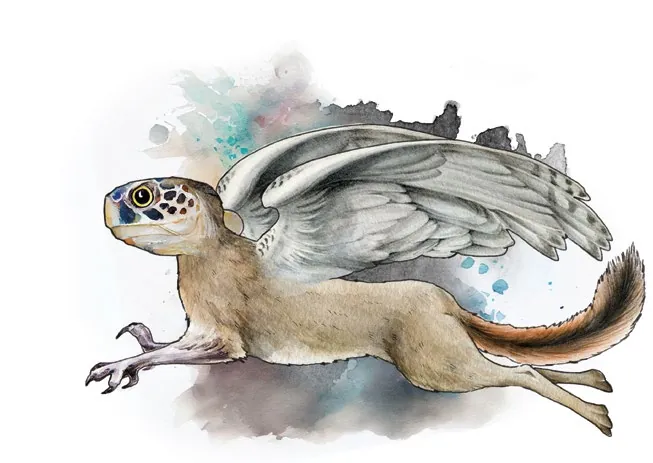

способами: если персонажи найдут одну из копий, а потом услышат её музыку откуда-то издалека, хотя сами её не открывали, это может сильно их смутить. Если они достанут свою, то обнаружат, что не могут ни открыть её (ни повредить), пока не смолкнет другая. Если персонажи уничтожат свою копию, а потом найдут новую, полностью восстановленную, это тоже выведет их из равновесия. Если же в конце концов они найдут несколько копий доктора, пройдя перед этим через все эти ситуации, это породит целый ряд сомнений и загадок совсем иного рода.

Поэтому вам, Хранителю, стоит продумать, как сыщики будут находить музыкальные шкатулки. Если у сыщиков уже есть одна, не стоит давать им найти ещё одну, спрятанную где-нибудь. Куда сильнее подействует, если они откроют шкаф и вдруг увидят перед собой полки, уставленные шкатулками, — или раскроют загадку чудесной починки шкатулки, или услышат её мелодию тогда, когда этого не может быть.

Как и машину Харона и мир мёртвых, музыкальные шкатулки можно убрать из истории, если в них нет нужды.

### Химера

Последнее оружие в арсенале лэрда — воображаемое появление чудовищного существа, которое существует лишь в умах сыщиков: доктор заложил его в их подсознание гипнозом. Внушение включается паролем, который знают лорд Дьюар, Элдон Дав, сиделка Реддинг, Хорас О’Коннелл и некоторые из его доверенных громил. Чаще всего к нему, вероятно, прибегнут охранники у ограды поместья, но в одной из тестовых партий воспользоваться им пришлось самому лорду Дьюару — чтобы спасти собственную жизнь.

Кроме того, есть ещё видение в хранилище (с. 110). Эта мысленная иллюзия запускается случайно и настигает сыщиков, когда они исследуют царство Аида. Сознание в этом царстве ничего не слышит, но подсознание слышит — поэтому внушение и срабатывает; этим же объясняется, почему сыщики так точно понимают сцены, которые видят, хотя никаких диалогов в них нет.

Если пароль произнесут при персонажах, они его не услышат, но он включит галлюцинацию, заложенную гипнозом в их подсознание. Чудовище явится им и погонится за ними, а у них не будет возможности ни сразиться, ни убежать, ни спрятаться. Если персонажи в лесу, оно выскочит из подлеска; если они в замке, оно может влететь в любое окно, спуститься по дымоходу или прорваться сквозь пол или стены. Только уверенность в том, что существо ненастоящее (для этого нужна как минимум трудная проверка МОЩ), позволит им одолеть это последнее препятствие на пути к свободе.

Если химера появится, любой ценой избегайте описывать её игрокам. Говорите им о чудовище, о твари, о её когтях и пасти, но не давайте никаких подробностей её облика. Сосредоточьтесь на чувствах, которые она вызывает, а не на её внешности.

Если потом персонажи станут обсуждать пережитое, позвольте каждому представлять существо как ему угодно и допускайте — и даже поощряйте, — чтобы их рассказы не совпадали. Если кто-то из игроков назовёт какую-то подробность о чудовище, а остальные её подхватят, это прекрасно вписывается в их податливость, вызванную гипнозом, которому подверг их лэрд. Если же они упрутся в то, каким было существо, прежде чем напасть на них, отказывайте им в любых подробностях и возвращайте им их же вопросы. Вряд ли они могут рассчитывать на общее воспоминание о мерзости, если у них нет даже общего описания существа. Внушение действует гораздо лучше, если они сосредоточены на ощущении паники, а психика каждого лепит образ зверя по его собственным страхам, а не ограничивается определённой картинкой.

То, что химера выглядит по-разному для каждого, кто её видит, даёт игрокам не такую ясную подсказку о происходящем, как может показаться на первый взгляд. Им легче поверить, что это какая-то сверхъестественная тварь, способная вызвать особый бред, подогнанный под личность каждого из пленников, чем прийти к выводу, что хищника на самом деле нет и он лишь порождение их самых безумных фантазий.
