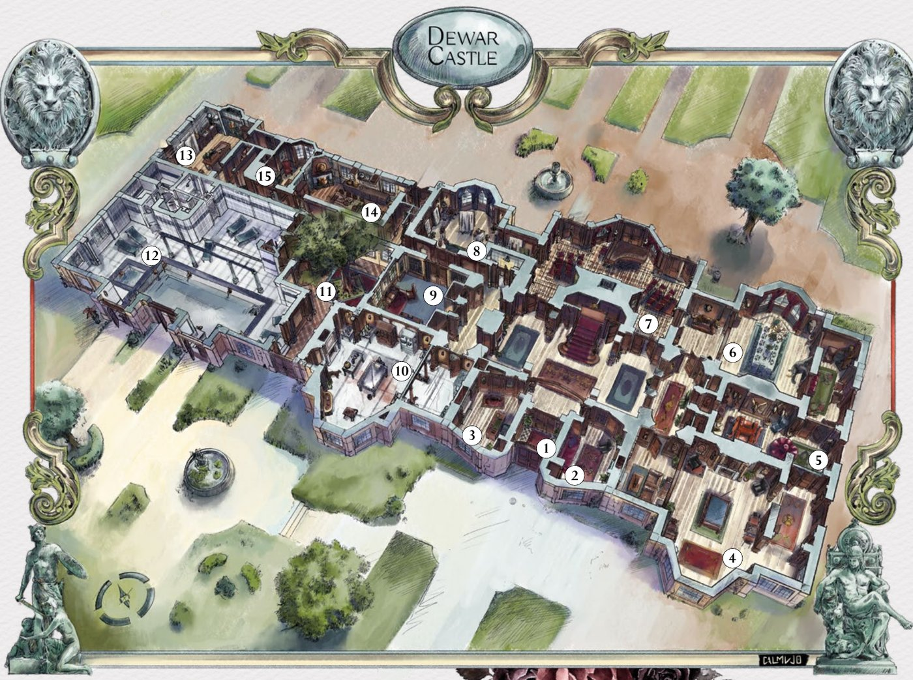

**Первый этаж**

| | | |
|---|---|---|
| 1. Главный вестибюль | 6. Столовая | 11. Тисовый атриум |
| 2. Комната ожидания | 7. Музыкальный салон | 12. Солярий и бассейны |
| 3. Кабинет Дава | 8. Мастерская художника | 13. Кухня |
| 4. Игровая комната | 9. Лазарет | 14. Столовая для гостей |
| 5. Гостиная | 10. Таксидермическая мастерская | 15. Курительная |
