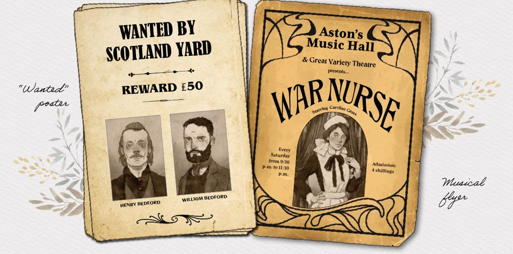

Сыщикам будет также совершенно ясно, что эти записи относятся исключительно к расходам на содержание замка и санатория — тем, чем обычно ведает дворецкий лэрда, — и не отражают ни арендных доходов, ни прибыли от дел аристократа, ни крупных сделок, ни вложений, ни благотворительных пожертвований, ни иных значительных движений капитала, которыми лорд Дьюар, несомненно, занимается сам (или поручает какой-нибудь солидной бухгалтерской конторе в Глазго). Это просто повседневные хозяйственные счета.

В одном из ящиков персонажи могут найти связку ключей, в которой есть дубликаты всех ключей от гостевых спален (Коллингвуда, Юнис и Бердетта), а также от их собственных спален, от лазарета, спальни леди Эдны и соседней процедурной, от семейного мавзолея и часовни. Разумеется, просто глядя на ключи, они не поймут, какой ключ к какому замку.

Наконец, без всяких дополнительных проверок сыщики могут найти сложенный в глубине ящика один из плакатов «Разыскиваются» с Генри и Уильямом Бедфордами, которые Скотленд-Ярд раздаёт в округе, или листовку мюзикла «Военная медсестра» (см. раздатки 3 и 4), а то и оба документа, если приключение зашло уже довольно далеко. Ни имена, ни лица, скорее всего, мало что скажут сыщикам, если только у них ещё не было кошмаров и тревожных галлюцинаций, — тогда игроки могут начать связывать воедино, кто же такие преступники, за которых обещана награда.

Чтобы открыть сейф, нужен ключ, который Дав всегда носит на шее. Кроме того, нужно знать комбинацию. Она есть у дворецкого и у лорда Дьюара, хотя Дав может солгать и сказать, что ничего не знает.

Чтобы набрать комбинацию, нужно повернуть три диска, у каждого из которых есть декоративная металлическая стрелка, похожая на часовую; на каждом диске она может указывать на одно из двадцати четырёх положений. Половина из них отмечена римскими цифрами на стальной поверхности дверцы. Всего возможно 13 824 сочетания.

Петли тяжёлой металлической двери расположены на стороне, противоположной петлям дверцы шкафа, и она тоже открывается наружу. Обе двери закрываются одна поверх другой.

То, что находится внутри этого надёжного помещения, вероятно, озадачит персонажей. Его целиком занимает пустая металлическая клеть, которая легко открывается (решётчатая дверь сдвигается и складывается). Внутри — зловещего вида рычаг с двумя положениями. На самом деле это лифт, спускающийся в шахту в земле и уходящий во тьму. Лифт работает на гидравлике, использующей подземный источник. При нажатии на рычаг опорожняется цистерна, и благодаря системе противовесов клеть поднимается. Затем она может сразу же снова спуститься (скорость спуска регулирует система шестерней и пружин), но чтобы подняться снова, ничего не остаётся, кроме как ждать, пока цистерна наполнится, а это добрых тридцать

> **Раздатка 3 (плакат «Разыскиваются»)**
>
> РАЗЫСКИВАЮТСЯ СКОТЛЕНД-ЯРДОМ
>
> НАГРАДА £50
>
> ГЕНРИ БЕДФОРД · УИЛЬЯМ БЕДФОРД

<!-- -->

> **Раздатка 4 (листовка мюзик-холла)**
>
> Мюзик-холл Астона и Большой театр варьете представляют…
>
> ВОЕННАЯ МЕДСЕСТРА
>
> В главной роли — Кэролайн Гейтс
>
> Каждую субботу с 21:30 до 23:30. Вход: 4 шиллинга
