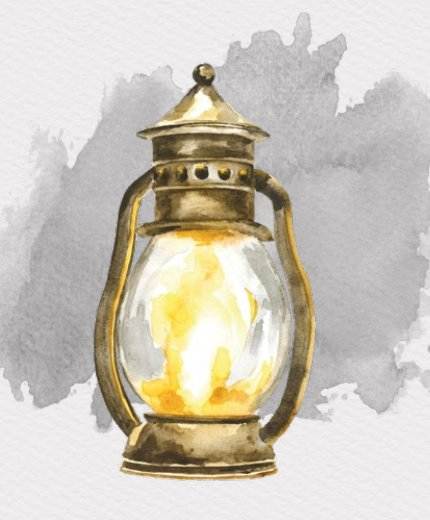

### Вспышки: прошлое Глэдис как натурщицы и новый аппетит Джаспера

Если Глэдис уступит настойчивым просьбам художника прилечь на кушетку, её захлестнёт чувство, что она уже позировала художнику, что уже лежала на этой кушетке раньше, хотя знает, что этого не может быть. Это чувство станет ещё зловещее, когда она обнаружит сходство тела Венеры на картине со своим.

Если Джаспер посмотрит на «Венеру» или на любую другую работу Коллингвуда с эротическим уклоном, он заметит, как женские изгибы на картине пробуждают в нём влечение — вплоть до того, что он чувствует возбуждение. Никогда прежде он не испытывал такого при виде женского тела.

Если, встревоженный этой реакцией, Джаспер решит вернуться и рассмотреть «Венеру» спокойнее, то — при условии, что это случится до его второго кошмара, — в нём проснётся чувство, что он уже видел это тело, хотя он не может сказать ни где, ни кому оно принадлежит.

### Отпечаток: ссора влюблённых — Артура и Глэдис

Когда возникает воспоминание, картины и кушетка исчезают, и комната принимает тот вид, какой у неё был, когда она служила для рукоделия. В большие окна светит солнце, но это сумеречный свет, золотой и красный, которого не хватает, чтобы как следует осветить комнату. Главный источник света — торшер рядом с тем местом, где сидит Глэдис Косгроув, напевая себе под нос и погрузившись в вышивание. Увы, в этом мире без звуков мы не можем услышать её мелодичный голос.

Артур входит в комнату как одержимый, и девушка вздрагивает — так сильно, что укалывает палец. Красные капли крови падают на безупречно белую ткань, которую она вышивает.

Но Артуру это ничуть не важно. Он продолжает отчитывать её: кровь приливает к его лицу, а вены на шее пульсируют так, что, кажется, вот-вот лопнут. Она пытается его успокоить, но Уилтшир не даёт ей и слова сказать. Он слишком разъярён. На глазах у Глэдис выступают слёзы, но и это не останавливает обличительную речь Артура.

Наконец Глэдис не выдерживает и, безутешно рыдая, выбегает из комнаты, а Артур продолжает выкрикивать ей вслед оскорбления, которые мир мёртвых, к счастью, скрывает от ушей сыщика.

Мало-помалу ярость Уилтшира утихает, и он остаётся один, растерянный, посреди комнаты. Он оглядывается, будто только что осознал, что натворил, и обхватывает голову руками.

Именно в этот момент воспоминание исчезает, хотя комната по-прежнему выглядит как комната для рукоделия, а не мастерская художника.

Ни Глэдис, ни Артур не могут вспомнить, чтобы у них когда-нибудь была такая ссора.

## 9. Лазарет

Эта комната служит доктору кабинетом для приёма пациентов. Это, без сомнения, самое уютное место в замке Дьюар. Её большие окна выходят на тисовый атриум, а стеклянная дверь находится напротив мастерской художника, отчего свет здесь рассеянный и спокойный, как летним вечером в тени яблонь. Ночью газовые бра дают достаточно света — не слишком яркого и не слишком тусклого.

Стены выкрашены в кремовые тона, а нижняя часть обшита панелями из вишнёвого дерева. Пол застлан ковром, а современный камин, обогревающий комнату, элегантен и удобен, без того тяжёлого, гнетущего стиля, что заметен в каминах других комнат особняка.

Украшений ровно столько, сколько нужно: несколько пейзажей, несколько ухоженных растений в горшках, книги на полках, несколько изящных бронзовых статуэток тут и там, изысканный набор перьевых ручек и чернильниц на столе доктора, шкафы со стеклянными дверцами, за которыми видны медицинские инструменты — все безупречно чистые и аккуратно разложенные, — красиво украшенные склянки с лечебными травами и так далее.

