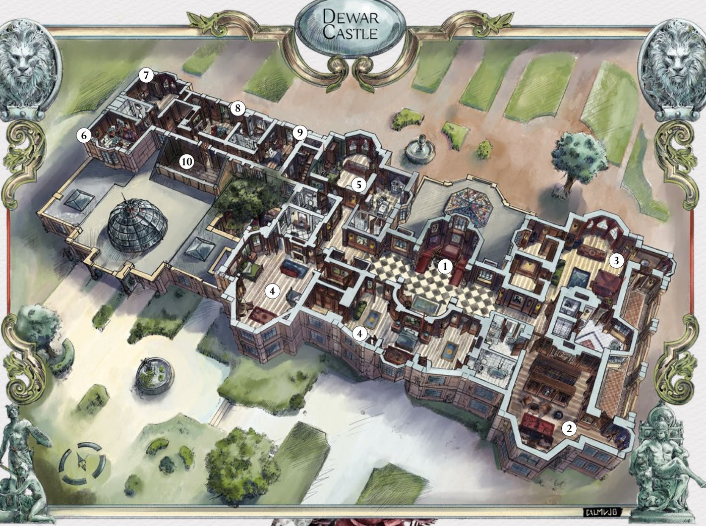

**Второй этаж**

| | | |
|---|---|---|
| 1. Лестничная площадка | 4. Спальни сыщиков | 7. Комната Ральфа Лаверика |
| 2. Кабинет и библиотека лорда Амадеуса Дьюара | 5. Покои леди Эдны и соседняя процедурная | 8. Комната Генриетты Юнис |
| 3. Личные покои лорда Амадеуса Дьюара | 6. Комната Джулиуса Коллингвуда | 9. Комната Виктора Бердетта |
| | | 10. Чердак |

*На карте две метки «4» — это две спальни сыщиков.*
