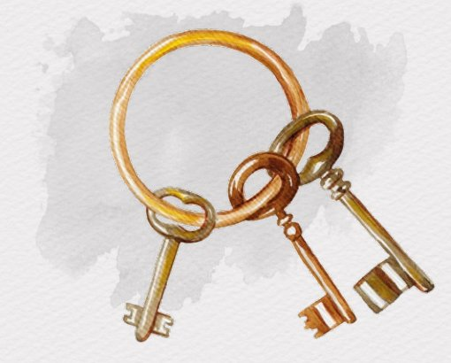

троих, и вы должны объяснить это игрокам. Если дела пойдут туго, кто-то из персонажей может решить предать товарищей: сорвать кольцо со старухи и бежать из поместья лэрда, бросив сообщников на произвол судьбы. Эта вполне реальная возможность измены должна висеть над всей группой, как дамоклов меч. Как Хранитель вы можете разжигать возникающую из-за этого подозрительность между персонажами, исподволь напоминая каждому, что нужно позаботиться о себе и забыть об остальных.

Если кто-то из сыщиков решит отрезать леди Эдне палец — а за это он, вероятно, возьмётся в одиночку, — восьмидесятилетняя старуха внезапно с леденящим душу воплем сядет, согнувшись в поясе, как вампир, встающий из гроба, с поразительной силой вцепится в руку того, кто её ранил, и уставится вору прямо в глаза. В конце концов сыщик сможет вырваться — резко выдернув руку или ударив старуху, — но потрясение и чувство вины заставят его пройти проверку Рассудка (потеря 0/1d4 Рассудка).

Такой поступок, весьма вероятно, приведёт к решающему противостоянию с лордом Дьюаром, который рано или поздно узнает, что случилось. Леди Эдна вряд ли оправится после такого потрясения, но выживет она или умрёт — существенно ход событий это не изменит.

В соседней комнате, обустроенной как процедурная, у сиделки Реддинг есть всё необходимое, чтобы ухаживать за леди Эдной и оказывать ей любую нужную помощь. Хотя комната большая, в ней тесно и душно — трудно описать почему. Может быть, потому, что потолок здесь несколько ниже обычного, или потому, что полки неудобно выступают, грозя рассеянному сыщику хорошей шишкой на лбу.

