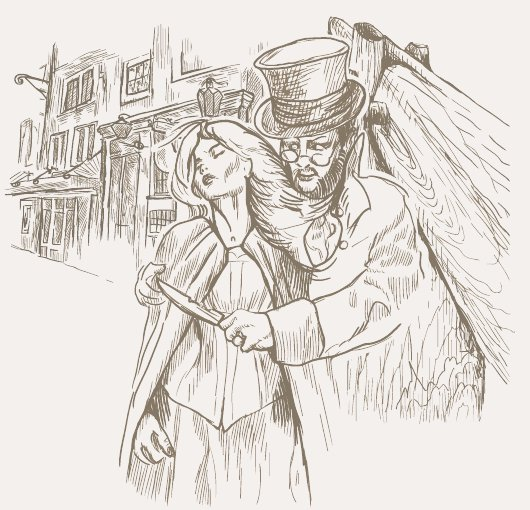

> **Примечание для Хранителя**
>
> Был ли отец Лаверик тем печально известным серийным убийцей, которого прозвали Джеком Потрошителем? Не потому ли прекратилась волна преступлений в Уайтчепеле, что он попал в руки лорда Дьюара? Если так, как он оказался узником в замке лэрда? Наткнулся ли на него аристократ случайно, когда искал женщину лёгкого поведения, которую можно было бы превратить в Глэдис Косгроув? Или они знакомы давно — из-за общего интереса к хирургии… или к каннибализму?
>
> Может быть, Лаверик был лишь грубым подражателем, которого первые преступления гнусного убийцы вдохновили выместить свою ненависть к женщинам на беззащитных жертвах. А может быть, он был всего лишь болезненно любопытным священником с нездоровым интересом к чудовищным преступлениям, совершавшимся по соседству.
>
> Истинное прошлое Лаверика для хода этого приключения не важно. Отсылка к уайтчепелским убийствам нужна лишь для того, чтобы добавить игре напряжения намёком, что персонажи, возможно, делят кров санатория с таким садистом. Подробнее разбираться в тайне преступлений Джека Потрошителя — за пределами этой книги и, вероятно, интересов ваших игроков, которые в какой-то мере это понимают. Поэтому они, скорее всего, не станут углубляться в эту тему и продолжат основную линию этой части — тем более что Лаверик, если он и есть Джек Потрошитель, похоже, совсем не в том состоянии, чтобы представлять для кого-то настоящую опасность.
>
> Во всяком случае, если вы хотите обыграть возможности, которые даёт этот исторический персонаж, советую вам собрать сведения и добавить в эту сцену подходящие подробности уайтчепелских убийств. Сегодня, когда сведения доступны прямо в интернете, это проще, чем когда-либо.
