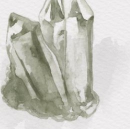

Первым идёт Дав, держа в руках огромные чёрные железные кандалы, соединённые тяжёлой цепью. За ним, неуверенно опираясь на трость, следует доктор Дьюар, а позади них наконец входит сиделка Реддинг, держа маленький металлический поднос со шприцами и хирургическими инструментами.

Дав аккуратно кладёт кандалы на кровать и перехватывает руку мужчины в тот самый миг, когда тот наносит последний удар, заламывая её за спину болезненным захватом, который заставляет его встать. Быстро схватив другую руку, он обездвиживает его и прижимает к стене. Мужчина — возможно, Лаверик — кричит и брыкается, но ничего не может поделать с ониксовым великаном. Дворецкий резко разворачивает его лицом к доктору, который взял скальпель с подноса сиделки Реддинг и медленно, угрожающе приближается к своей жертве. На лице лэрда пляшет улыбка, когда он острым лезвием инструмента обводит контур трахеи кающегося. Глаза мужчины наполняются ужасом — это выражение сыщик теперь без тени сомнения узнает: это неизменная гримаса муки на лице забинтованного человека, Ральфа Лаверика.

Гримаса паники отпечатывается на сетчатке персонажа, наблюдающего эту сцену, пока та растворяется в воздухе.

## 8. Спальня Генриетты Юнис

У пожилой миссис Юнис комната с собственным камином и отдельной ванной.

Она выглядит в точности так, как и ожидаешь от комнаты старой вдовы: тут и там разбросаны памятные вещицы, недорогие, но, скорее всего, очень дорогие сердцу; одежда аккуратно выглажена и разложена в шкафу; под кроватью — ночной горшок, забрызганный кровью, который старуха использует как плевательницу; очень потрёпанный старый сундук, обклеенный наклейками разных гостиниц со всего света; кресло-качалка; и воздух, полный ладана и экзотических ароматов, заглушающих неизбежный запах старости.

Дверь запирается на замок, и комната обычно заперта — внутри ли Генриетта или вышла, — но взломать замок нетрудно (проверка Механики с бонусной костью).

### Находки: оккультная утварь

Если сыщики обыщут комнату, на дне сундука в изножье кровати ясновидящей они без всяких проверок могут найти: доску уиджа; маятник из цитрина; завёрнутую в ткань статуэтку Ганеши, индуистского бога со слоновьей головой; синий бархатный мешочек, полный птичьих костей, и очень старый на вид амулет, сплошь покрытый египетскими иероглифами, — на самом деле его сделали и купили в Норидже. Это оккультная утварь без всякой ценности и особой пользы.

### Отпечаток-выход: женщина между двух миров

Когда сыщик входит в эту комнату, фигура мадам Юнис уже здесь: она спит в своей постели (или сидит в кресле-качалке, если это больше подходит ко времени суток, когда проводится эксперимент).

Когда персонаж входит, старуха внезапно просыпается (или вздрагивает и просыпается), оглядывается, осматривая комнату, а затем останавливает взгляд на сыщике и смотрит ему прямо в глаза.

Медиум встаёт и подходит к незваному гостю, и впервые в мире мёртвых слышен звук. Голос семидесятилетней старухи звучит очень молодо, почти по-детски. В нём нет ни кашля, ни дрожи, ни хрипоты, что контрастирует с её морщинистым, иссохшим видом.

Предостережение миссис Юнис зависит от того, как развивались события в замке Дьюар и каковы её отношения с группой сыщиков. Точное содержание её послания решаете вы, Хранитель, хотя я советую, чтобы оно было таким же туманным, как её обычные увещевания, и чтобы в нём была скрытая, но довольно прямая отсылка к превращению, которое персонаж претерпевает в загробном мире.

Если уместно, можно добавить и другие призрачные образы, дополняющие её слова и завершающие сказанное. Сыщик может заметить, как её руки и всё

