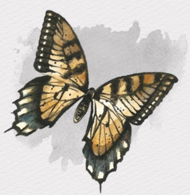

вообразить. Книга выглядит совсем новой; вероятно, это одно из первых в мире изданий, напечатанных хромолитографией — цветной печатью.

Юный Амадеус с изумлением в глазах рассматривает куколки и, листая страницы, вглядывается в цветные иллюстрации, как вдруг замечает, что одно из насекомых начинает прогрызать себе путь из кокона. Сначала высовывается пара крошечных челюстей, потом вся голова, и, протискиваясь сквозь отверстие, появляется первый мотылёк.

У этого существа чёрные крылья, словно покрытые шерстью или грязью, и выглядит оно скорее угрожающе, чем как-либо ещё.

Амадеус разочарован.

Тут начинают лопаться и другие куколки, и из них выбираются всё новые уродливые чёрные мотыльки, которые роем кружат вокруг пламени канделябра.

Амадеус пугается.

Мотыльки начинают садиться на него. Они по-настоящему отвратительны. Они садятся на страницы книги, закрывая прекрасные иллюстрации своими тёмными крыльями.

Амадеус выбегает из комнаты, бросив канделябр и оставив книгу посреди чердака, а насекомые начинают массово выбираться из коконов, заполняя всё пространство. Они кружат вокруг пламени, и этот рой пыльных крыльев начинает расползаться и рассеиваться, превращаясь в вихрь пепла, который постепенно сходит на нет, — и видение заканчивается.

# Третий этаж

## 1. Лестничная площадка

Главное достоинство этого помещения в том, что оно светлое, хорошо обогревается и из его многочисленных окон открываются великолепные виды на земли замка. Здесь два камина, в которых часто греют утюги и готовят угли для грелок, согревающих постели господ, а также несколько потрёпанных старых стульев и кресел, которыми, вероятно, пользуется прислуга в перерывах.

Пол из простых деревянных досок, старых и сильно истёртых, которые скрипят, когда на них наступаешь, — что очень на руку лэрду и его замыслам. Нет никаких ковров, которые защищали бы доски или смягчали шаги входящих, так что любая проверка Скрытности, которую могут проходить сыщики, делается со штрафной костью. Подняв глаза, можно увидеть массивные открытые деревянные балки, на которых держится крыша замка Дьюар, — это исключает возможность, что над ними спрятан чердак.

Площадка соединяет два коридора, слева и справа — в зависимости от того, по какой лестнице подниматься; один из них ведёт в комнату с машиной Харона и в Галерею химер, другой — в лабораторию лорда Дьюара и личные покои мистера Дава.

В обоих коридорах есть вместительные кладовые шкафы, где хранятся полотенца, простыни, подушки и всё постельное бельё, нужное для всего замка, а также метёлки из перьев, мыло, мётлы, щётки, вёдра, гладильные доски, корзины, складные сушилки для белья и даже небольшая тележка для уборки. Мисс Милфорд гладит на этой площадке высохшее бельё, а в дождь развешивает здесь мокрое, пользуясь жаром каминов, чтобы оно быстрее сохло.

