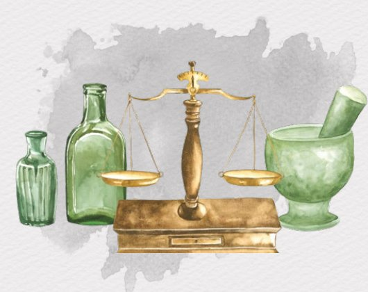

флакон запечатан герметично. Сосуд круглый, почти шарообразный, с длинным стеклянным горлышком.

Джаспер несколько мгновений держит его, пристально разглядывая с непроницаемым выражением лица, и наконец решительным шагом выходит из комнаты.

Переступив порог, он растворяется в воздухе, и на этом сцена заканчивается.

Аристократ не сможет вспомнить этот эпизод своей жизни, но без дополнительного контекста это могла бы быть просто незначительная подробность, которую он забыл. Однако, судя по тому, что они уже видели, отпечатки обычно не показывают пустяковых событий, не имеющих последствий.

## 3. Комната Элдона Дава

Для комнаты слуги спальня немаленькая. В ней свой камин и отдельная ванная, а вид из окна потрясающий.

Как и следовало ожидать, в комнате порядок и чистота, но видна и скромность. Мебели немного, поэтому много свободного места. Создаётся впечатление, что Дав проводит здесь мало времени и остаётся в этой комнате ровно столько, сколько нужно, чтобы выспаться. Кроме кровати, старого шкафа и плоского сундука из дерева и металла, здесь только пара скамеек и обшарпанный стул у камина, глядя на который можно задуматься, сидеть ли на нём у огня или пустить его на дрова. Впрочем, похоже, камин не разжигали уже много лет.

Пол из деревянных досок, лишь крошечную его часть закрывает маленький серый коврик. Потолок с открытыми балками, снизу видны следы недавнего ремонта крыши. Комната запирается, и Дав непременно запирает её, когда уходит, хотя, находясь внутри, обычно этого не делает — разве что опасается тайного нападения сыщиков, пока спит.

### Находки: портрет Кэролайн Гейтс, безделушки и ещё ключи от поместья

Если листовка не появилась раньше в каком-нибудь другом месте, сыщики найдут между матрасом и деревянным изголовьем аккуратно сложенный листок бумаги. Это листовка, рекламирующая музыкальный спектакль — премьеру представления «Военная медсестра» (раздатка 4). На переднем плане — лицо женщины, которую сыщики поначалу не узнают, подписанное именем Кэролайн Гейтс: это настоящее имя Глэдис. Если листовка оказывается у Дава (здесь или в другом месте), значит, именно дворецкий нашёл Кэролайн, когда обшаривал лондонские закоулки в поисках замены покойной Глэдис. Через неё он вышел на братьев Бедфорд — один из них был её клиентом, — чтобы соблазнить их заманчивым рассказом о сокровище лэрда. Девушка показалась ему тогда красивой и кажется такой до сих пор, и хотя его преданность доктору Дьюару непоколебима, он не может не чувствовать укола вины за судьбу, которую они ей уготовили, — как и ревности к Артуру, который её уж точно не заслуживает.

Поэтому, вопреки здравому смыслу, он сохранил её портрет.

Чтобы найти этот листок, нужно пройти проверку Внимания с бонусной костью — или он находится автоматически, если сыщики не спеша обыщут комнату.

На дне сундука, под одеялами, персонажи могут найти связку ключей с дубликатами ключей от их спален, от чердака, который иногда служит тюремной камерой (с. 82), от лаборатории и от шкафов в ней, где хранятся
