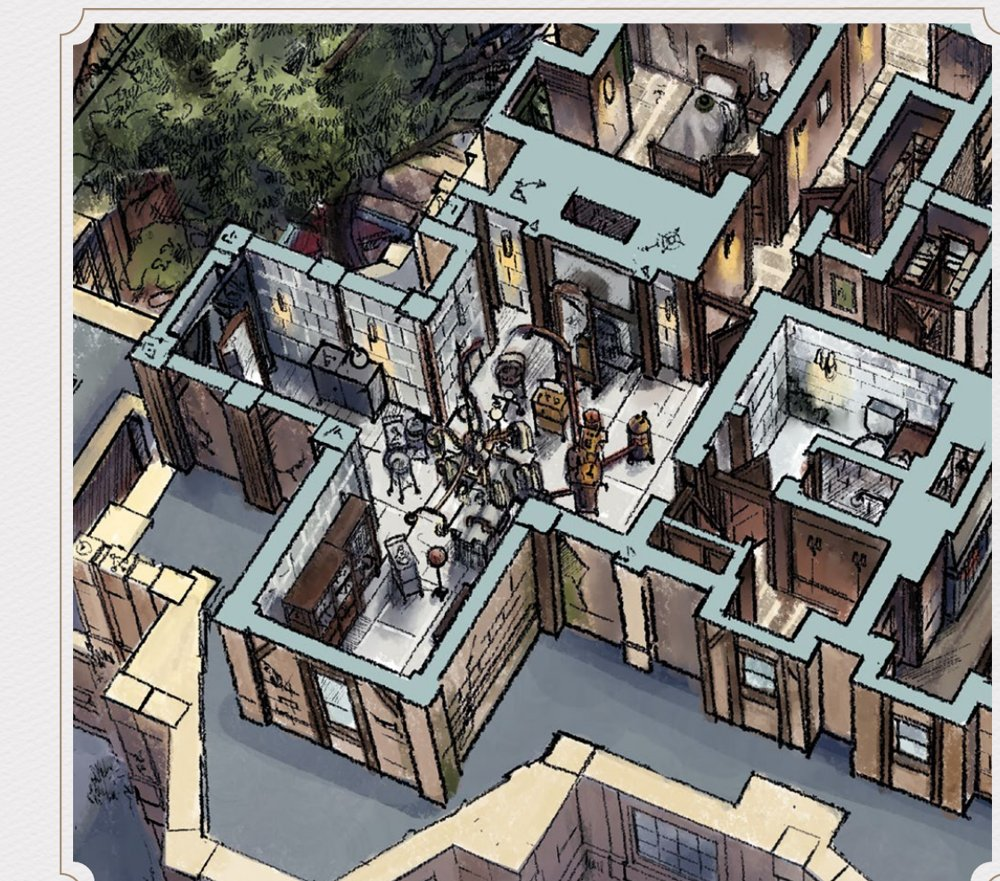

И на кухне, и в кабинете Дава есть шнур колокольчика без подписи, который звонит отсюда.

Помещение всегда заперто, и ключ есть только у лорда Дьюара. Впрочем, замок здесь не такой хитрый, как тот, что охраняет лабораторию: доктор знает, что в этой комнате мало вещей, которыми сыщики могли бы навредить. Они могут сломать машину или испортить её, но перед каждым запуском лорд Дьюар и сиделка Реддинг всегда тщательно проверяют, всё ли оборудование в порядке и безупречно ли работает. Делают они это не из страха перед диверсией, а потому, что вмешательства, которые здесь проводятся, чрезвычайно тонки и ничего нельзя оставлять на волю случая. Они промывают трубки деионизирующей жидкостью, проверяют давление и мощность электрического тока и следят, чтобы все инструменты были правильно откалиброваны. Испортить опыты Дьюара практически невозможно — тем более тому, кто понятия не имеет, как работает здешняя аппаратура. Тем не менее медицинская команда будет вдвойне осторожна, если заметит хоть какой-то признак того, что сыщики тайком рылись в этой комнате.
