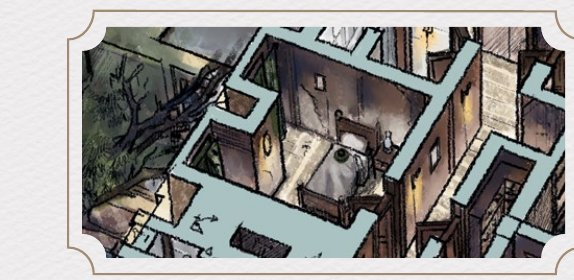

На двери нет замка — нет даже жалкой задвижки, которая дала бы юной служанке хоть немного уединения. Зато, когда её открывают, она скрипит как чёрт, предупреждая того, кто внутри. Скажи спасибо и за малое.

### Находки: лестница из ветвей, отмычки и платье Фиделии

Занавески на окне обычно задёрнуты. Если их раздвинуть (для этого не нужны проверки — только обыск комнаты), сыщики обнаружат, что ветви дерева подходят к подоконнику почти на пядь и изгибаются так, что по ним очень легко спуститься на два этажа, отделяющие эту комнату от земли. Не нужна даже проверка Лазания: опоры будто образуют естественную винтовую лестницу, обвивающую дерево.

Как уже говорилось, кровать покрыта пылью. На первый взгляд это может показаться ещё одним признаком запущенности, но проверка ИНТ позволит игрокам рассудить, что такое количество сора могло скопиться на простынях лишь по двум причинам: либо по какой-то причине через окно (или откуда-то ещё) сюда налетает уйма грязи, либо с балок над кроватью сыплется много древесной трухи. Или же в кровати не спали уже много месяцев.

Проверка Внимания со штрафной костью позволит персонажам найти пожелтевший изжёванный носовой платок с грубо вышитыми в углу инициалами MB, который, должно быть, проскользнул через дыру в подкладке одного из карманов пальто; два пенни и три шиллинга; а также три-четыре обрывка жёсткой скрученной проволоки длиной с палец, в которых персонажи без всяких проверок узнают какие-то примитивные отмычки.

Наконец, в одном из ящиков комода, аккуратно сложенное, Элизабет Милфорд хранит красивое платье, принадлежавшее покойной Фиделии, — возможно, сыщики уже видели, как она бродит в нём по садам посреди ночи. Наряд цвета слоновой кости украшен очень характерной вышивкой, так что если он уже привлёк внимание персонажей (потому ли, что они рассмотрели портрет Фиделии в кабинете лорда Дьюара, потому ли, что видели, как загадочная фигура в этой одежде бродит вокруг замка, или, например, заметили его в отпечатке в комнате ожидания, когда она забирала музыкальную шкатулку), они узнают его, едва открыв ящик, без всяких проверок. Если они не помнят этого платья, то при обыске комнаты, пусть даже поверхностном, всё равно получают право на проверку ИНТ: даже если цвет ткани можно спутать с нижним бельём служанки, её фактура и атласный блеск не оставят сомнений в высоком качестве материи. Если развернуть наряд и увидеть тонкость кружева, становится ясно, что такую одежду меньше всего ожидаешь найти в подобном месте.

### Вспышки: бедность привычна и уютна

Войдя в эту комнату, сыщики могут испытать странное чувство узнавания. Именно в таком жилье они прожили бо́льшую часть жизни, и оно им совершенно привычно. Однако, описывая это чувство, подавайте его так, будто впечатления необъяснимы, парадоксальны и противны их инстинктам, подчёркивая неприглядные стороны комнаты:

«Вы не знаете, почему и как, но, несмотря на всю унылость комнатки, в этом жалком жилище есть что-то — словно какая-то мистическая сила, — что встречает вас радушно и манит войти. В этих четырёх стенах вы испытываете необъяснимое чувство защищённости… ощущение, которое как нельзя сильнее расходится с отвращением, что вызывают у вас убожество и теснота этой мрачной, грязной, жалкой дыры».

### Отпечаток: любовник леди Эдны

Обстановка комнаты полностью меняется. Теперь она целиком отведена под глажку белья и используется лишь несколько раз в неделю, а потому идеально подходит для тайных свиданий, о которых лучше никому не знать.

Фигура, проступающая в комнате, — не служанка, а молодая леди Эдна, которая нетерпеливо расхаживает из угла в угол, потирая руки. При этом она замечает на пальце обручальное кольцо. Она тянет дорогое венчальное кольцо, пока не стаскивает его с пальца, и бросает в первый попавшийся ящик — к ароматическим средствам для чистого белья, отбеливателю и крахмалу.

Тот, кого она так нетерпеливо ждёт, появляется скоро, но входит не в дверь, как можно было бы ожидать, а через
