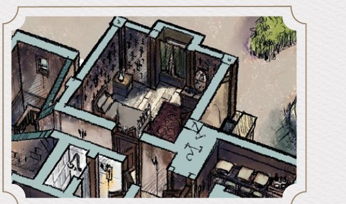

окно, без всякого труда взобравшись по ветвям дерева. Улыбающийся юноша — не кто иной, как Колумбус Тведдл, но, скорее всего, сыщик не сможет его узнать, если не видел его фотографии. Хотя на ней он заметно старше, черты его узнать будет нетрудно.

Леди Эдна буквально стаскивает его с подоконника и тянет за собой в комнату, осыпая страстными поцелуями. Поначалу юноша, кажется, тревожится, что их кто-нибудь услышит или застанет на месте преступления, но вскоре и он отдаётся безудержной страсти женщины и предаётся с ней любви.

Эдна срывает с джентльмена рубашку, и, когда ткань рвётся, рвётся и картина: она разлетается на осколки, будто разбросанная энергией страсти пылкой молодой женщины, и растворяется во тьме воспоминания.

## Комната Леноры Реддинг

Спальня сиделки находится прямо у лестницы, ведущей на этаж ниже. Так ей достаточно спуститься на несколько ступенек, чтобы попасть в комнату леди Эдны и прийти к ней, как только понадобится. Колокольчик у изголовья кровати звенит, если кто-нибудь дёрнет шнур в комнате леди Эдны. Впрочем, звонил он уже очень давно.

Стены комнаты увешаны распятиями всех мыслимых форм и материалов. Здесь есть деревянные, железные, бронзовые, серебряные и несколько золотых; большие, средние, маленькие и крошечные. На одних крестах — Христос, другие — не более чем две перекрещённые деревяшки. Одни украшены резьбой и гравировкой, в другие вставлены камни. Есть латинские, византийские, апостольские. Есть кресты святого Петра (перевёрнутые — они могут навести сыщиков на мысль, что это нечто иное, чем есть на самом деле), кресты святого Антония, каравакские, тринитарские и так далее.

Кроме неубранной кровати и старинного платяного шкафа из оливкового дерева, у сиделки Реддинг есть небольшой туалетный столик из вишнёвого дерева с полкой белого мрамора и овальным зеркалом, знававшим лучшие времена. Из изящных опор зеркала торчат два подсвечника, покрытые потёками воска, свисающими почти до пола.

Пол комнаты покрыт большим неброским ковром — толстым, но тусклым. На двери есть замок, и миссис Реддинг обычно им пользуется — и когда она в комнате, и когда уходит. Забывает она редко, но если ей приходится выйти в спешке — например, по срочному вызову из комнаты леди Эдны или услышав тревожный шум, — это может вылететь у неё из головы. Как уже говорилось, ванную напротив своей двери сиделка делит с мисс Милфорд, хотя часто пользуется ванной этажом ниже.

### Находки: листовка мюзикла и помилованные мыши

Если сыщики ещё не нашли ни одной рекламной листовки пьесы «Военная медсестра» с Кэролайн Гейтс в главной роли (раздатка 4), сейчас они находят экземпляр — аккуратно сложенный, в одном из ящиков туалетного столика вместе с другими фотографиями и рисунками красивых женщин. Можно намекнуть сыщикам, что сиделка, скорее всего, копирует с этих набросков причёски и макияж (хотя мы уже знаем, что правда несколько пикантнее), и сказать им, что по какой-то необъяснимой причине именно это изображение притягивает их взгляд, словно оно им что-то напоминает, хотя они никогда его раньше не видели.

Шкаф заперт, но ключ можно найти в другом ящике туалетного столика: хватит проверки Внимания с бонусной костью. Замок можно и взломать (без проверки) или вскрыть шпилькой для волос (проверка Механики с бонусной костью).

