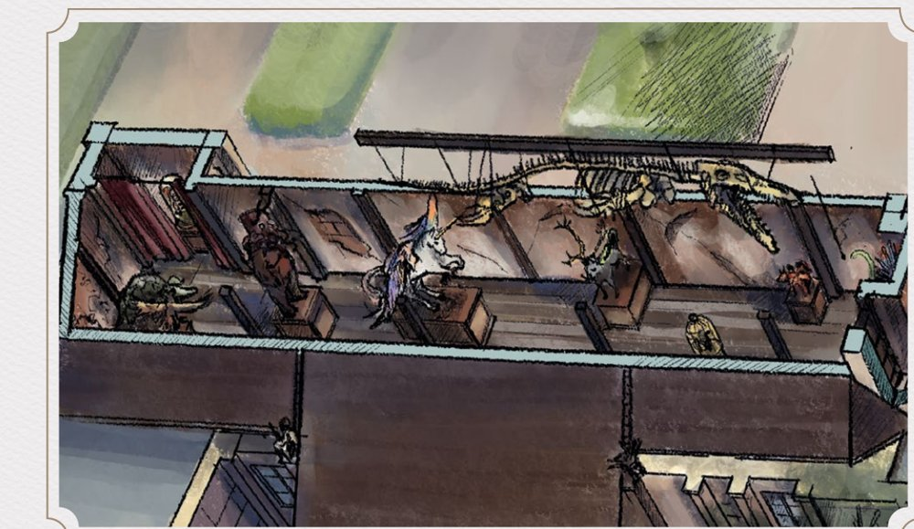

Первый экспонат экскурсии — лиса о двух головах, к бокам которой приделаны два крыла чёрного грифа. За ней — куропатка со змеиной головой; лорд Дьюар скажет, что это василиск, способный обратить в камень любого одним взглядом. Затем — волк, чьи зубы заменены кривыми клыками нескольких кабанов; к нему приделаны особенно острые оленьи рога, а хвост заменён телом змеи — вероятно, той самой, чья голова красуется на теле куропатки.

Хотя работа таксидермиста достойна похвалы, искусственное происхождение этих чудовищ ясно всем. Это изобретательная выставка, даже, можно сказать, слегка тревожная, но она никого не обманывает.

Затем лэрд обращает внимание группы на середину помещения, где выставлен белый конь, вставший на дыбы и опустивший голову, будто готовясь к атаке, с витым рогом на лбу — вероятно, от рыбы-меча или другого подобного морского существа. Доктор приделал ему огромные полураскрытые крылья из перьев по меньшей мере пятидесяти гусей, чтобы довершить иллюзию Пегаса.

Лорд Дьюар обводит чердак лучом фонаря. На проволоке к центральной балке подвешен костяк, собранный из бог знает каких костей — быть может, из позвоночника косатки или кита, — изображающий скелет мифического дракона.

Хозяин попытается воспользоваться этим отвлечением, чтобы сыщики развернулись и пошли обратно, так и не обнаружив маленькую нишу, скрытую за простой занавеской в глубине помещения (см. раздел «Находки» ниже).

Следующее творение — взрослый медведь, вероятно тот самый, чья голова выставлена в гостиной; его голова заменена головой гигантского спрута. Большие участки груди и живота выбриты, чтобы он походил на гориллу, а на затылке спрута торчат два бычьих рога, загнутых вперёд над головой, что придаёт ему демонический вид. Вся композиция выкрашена в алый цвет — довольно пятнисто и, вероятно, не так внушительно, как надеялся лорд Дьюар.

Рядом с этим огромным зверем — сокол, голова которого заменена головой большой крысы. Дальше виден колоссальный серый панцирь гигантской галапагосской черепахи, к которой лорд Дьюар приделал хвост, голову и лапы каймана, а у выхода — павлин с
