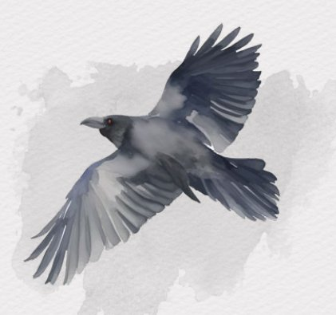

### Отпечаток: страх Амадеуса перед темнотой

Существа в помещении превращаются в старую мебель и хлам под пыльными чехлами. Так здесь куда менее жутко, но и это способно наполнить тревогой детское сердце — особенно если у ребёнка живое воображение.

Именно это и происходит, когда маленький Амадеус входит на чердак при свете одной лишь свечи вместе с отцом.

Лорд Оуэн ведёт сына на середину помещения, а ребёнок оглядывается, полный тревоги. Ему не больше четырёх-пяти лет, и он оцепенел от страха. Взрослый решительно указывает на место в комнате; малыш идёт туда и встаёт, а отец твёрдым шагом направляется к двери, оставляя сына одного в мерцающем свете свечи.

Отец, чей силуэт вырисовывается в дверном проёме, что-то говорит сыну, но этого не слышно. Мальчик испуганно мотает головой. Лорд Оуэн угрожающе шагает вперёд, грозит пальцем и, вероятно, повышает голос. Маленький Амадеус ещё крепче сжимает свечу, подбородок у него начинает дрожать. Кажется, он вот-вот расплачется. Отец теряет терпение. В два шага он оказывается рядом с сыном и гасит пламя, зажав его двумя пальцами.

Маленький Амадеус бежит к двери, но лорд Оуэн хватает его за шиворот и поднимает в воздух. Он швыряет его в большое кресло под пыльным чехлом и быстрым шагом идёт к двери. Мальчик пытается бежать за ним, но в темноте спотыкается о ящик и не успевает добежать до отца, прежде чем тот запирает его на чердаке.

Темнота абсолютная. Невозможно понять, что было дальше и закончилось ли воспоминание. Всё черно и безмолвно.

