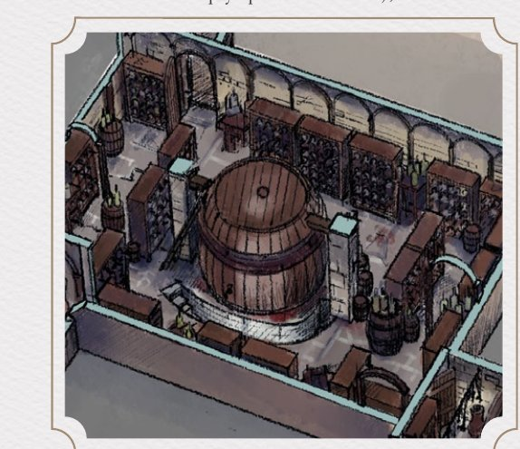

догадаться, что когда-то место, занятое теперь чаном, занимал огромный винный пресс. Механизм того же типа, что и ручные прессы в соседней комнате, — это тоже может подтолкнуть сыщиков попробовать разгадать загадку. Игрокам предстоит самим сообразить, куда девается сусло, выжатое из винограда. Его вполне можно было бы собирать обычным способом, каким сливают из чана перебродившую жидкость, но на самом деле жидкость уходит в подземный резервуар, ныне скрытый колоссальной ёмкостью.

Резервуар, стены которого выложены глазурованной плиткой, — то место, где доктор Дьюар хранит расчленённые останки тел Джаспера, Артура и Глэдис в химическом растворе собственного изготовления. В отличие от формалина и других обычных бальзамирующих жидкостей, спиртовой состав Дьюара не ядовит, если перед готовкой тщательно промыть мясо.

Всякий, кто оценит размеры чана, закрывающего вход в эту жидкую могилу, решит, что сдвинуть его невозможно, даже совершенно пустой, разве что полдюжины здоровяков навалятся на него разом. Даже сдвинуть его полным хотя бы на полсантиметра немыслимо; опрокинуть его каким-нибудь рычагом трудно себе представить, потому что он частично утоплен в пол, который прочно удерживает его на месте. По сути, огромный чан сдвинуть нельзя.

Однако, вопреки всякой очевидности, под него можно попасть.

Внутри чана есть отсек диаметром примерно 2 м и высотой почти 4 м (5 м, если считать пустое пространство под ним), который остаётся нетронутым суслом и открыт кверху как раз там, где проходят опорные балки. Это словно ещё одна ёмкость внутри главного чана, и в ней находится люк в резервуар внизу.

Вот как попасть в эту дополнительную внутреннюю камеру.

В самом широком месте участок деревянной стенки колоссальной бочки, если на него сильно надавить, откидывается внутрь и вверх, открывая доступ в скрытую камеру. Стыки идеально замаскированы между двумя металлическими обручами, а тяжёлая дверца к тому же запечатана и покрыта суслом. Петли расположены на верхней раме, изнутри, а внизу — кромка с двойным скосом, позволяющая открыть участок стенки чана, несмотря на толщину в 60 см. Система противовесов внутри чана позволяет открывать его без труда, а механизм к тому же фиксирует дверцу в открытом положении, когда она поднимается до определённой высоты. Освободить её можно, толкнув повыше и отпустив.

Есть и засовы, которые автоматически запирают люк, когда он захлопывается на нижние запоры, расположенные с обеих сторон, — чтобы дверца не открылась случайно, если кто-то на неё обопрётся, или если она закроется неплотно. Эти засовы отпираются, если потянуть за фальшивую заклёпку на нижнем краю, соединённую с цепочкой, которая пружинным механизмом возвращает заклёпку на место.

Люк находится в том участке стенки чана, где спускается полукруглая лестница. От входа в погреб его не видно; к тому же он немного приподнят над полом. Неплохо было бы иметь какую-нибудь скамеечку, чтобы подтянуться к тайному входу, или забраться на одну из бочек поменьше или винных ящиков поблизости. К наружной стенке чана приделана лестница, но она закреплена с противоположной стороны, на высоте крана. Внутри у камеры есть свои ступени, чтобы входить и выходить.

Оказавшись во внутренней камере, легко понять, как работают разные механизмы и, что важнее, как открыть люк, закрывающий отверстие в подземный резервуар. Если сыщики проникнут сюда, постарайтесь передать, как удушающе тесно здесь, когда со всех сторон тебя окружает жидкость, будто ты вернулся в материнскую утробу. Если они снимут крышку резервуара, опишите, как свет факела отражается на тёмной маслянистой поверхности жидкости, колышущейся у них под ногами, и как он отбрасывает волнистые тени на деревянный потолок чана. В тайной кабинке стоит прислонённая к стене рыболовная сеть и пара длинных багров, которыми вылавливают части тел, плавающие в жутком резервуаре внизу.

Обнаружение этих человеческих останков требует проверки Рассудка (потеря 1/1d6 Рассудка).
