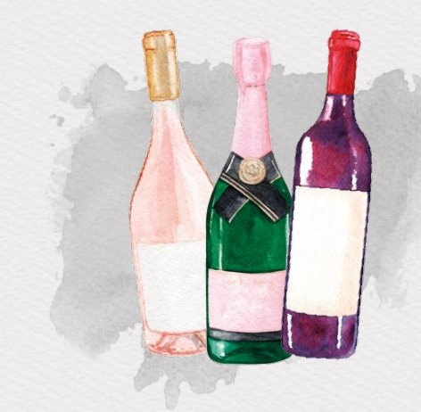

Разумеется, нельзя исключать и того, что сыщики найдут чертежи, которые лорд Дьюар дал плотникам (раздатка 7), и раскроют тайну чана таким путём.

Учтите: даже если они найдут резервуар с трупами и попытаются извлечь из жидкости все части, которые ещё не съели, опознать тела они, скорее всего, всё равно не смогут — по крайней мере, без больших трудностей.

Находка менее откровенна, чем может показаться поначалу. Она, конечно, очень тревожна, но не даёт сыщикам ясного представления о том, что здесь может происходить. Всё указывает лишь на то, что лэрд (или, возможно, Дав) — опасный убийца, не более. Даже если находка приведёт к преждевременному противостоянию с лордом Дьюаром, он может заявить, что это анатомический материал для его научных занятий (что, строго говоря, не ложь), и попытаться отвлечь их внимание разговорами об исследовании мира мёртвых.

### Отпечаток: шалость Артура и Джаспера

У входа в подземный погреб начинает разгораться свет двух ламп. Благодаря ему сыщик замечает некоторые изменения в помещении по сравнению с тем погребом, который он помнит, если бывал в нём когда-нибудь в мире живых. Главное отличие — на месте, которое ныне занимает чан для брожения, стоит корзинчатый винный пресс. Винтовой поршень закреплён на прочной деревянной балке, а большое колесо со спицами прикреплено к другой балке и соединено с ещё одним металлическим рычагом, который двое мужчин могут вращать, чтобы поршень давил виноград.

Но двое только что вошедших вовсе не собираются давить виноград.

Не столько мужчины, сколько два парня. Одному на вид лет пятнадцать, другому едва ли больше восемнадцати. Это Артур и Джаспер, которые, судя по поведению, решили тайком забраться в винный погреб своего дяди Амадеуса, чтобы стащить немного вина.

Оба смеются и шутят, хотя мы не слышим, о чём они говорят. Они дурачатся, шутливо борются; забираются на бочки, хохоча, делая вид, будто скачут верхом на резвых жеребятах наперегонки; вдруг прячутся, когда им кажется, что они услышали шум — будто кто-то сейчас ворвётся и застанет их. Они прикрывают факелы ладонями, пока Артур не обжигается, а Джаспер над ним потешается. Они читают этикетки на бутылках, будто прекрасно в них разбираются, откупоривают те, что им приглянулись, вливают вино себе в глотку и чокаются друг с другом.

Шалость продолжается: они спускаются в боковую крипту и безуспешно пытаются взломать замок на личной коллекции вин лэрда. Они бьются над ним изо всех сил и случайно обливаются вином. Потом уже нарочно обливают вином друг друга. Они хохочут, катаются по полу, открывают новые бутылки и продолжают пить.

Артур не поспевает за Джаспером. Он не допил и второй бутылки, как приваливается к товарищу по проделкам и начинает засыпать. Пропитанные вином кудри падают ему на лицо и оставляют на нём винные разводы. Джаспер ласково убирает их и гладит его по лицу. Он пару раз легонько хлопает его по щеке, чтобы разбудить, но Артур лишь слегка хмурится и продолжает спать. Свет лампы освещает его милое юное лицо. Джаспер гладит его, а затем робко и коротко целует его в волосы. Затем в щёку. Затем касается губами губ друга. Он нежно облизывает губы Артура, придерживая его голову, а другой рукой начинает расстёгивать пуговицы мокрой рубашки и гладит гладкую грудь товарища по играм. Потом опускает руку к плоскому животу друга, пока не добирается до пояса его брюк…

Сцена исчезает, а ни одно из ухаживаний Джаспера Брамли так и не разбудило юного опьяневшего Артура Уилтшира.

Если сыщики видели это видение или если Глэдис им о нём расскажет, ни Джаспер, ни Артур не вспомнят ничего подобного, хотя, честно говоря, у кого не бывало таких попоек, после которых в памяти — полный провал?

