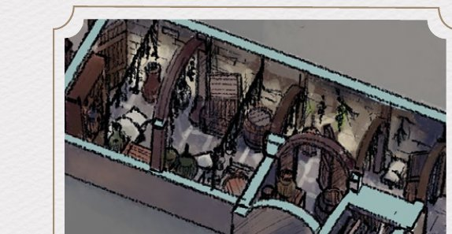

## Кладовая

Оставив позади винный погреб, попадаешь в древний комплекс помещений и туннелей, вырытых ещё в римскую эпоху, с низкими потолками, маленькими дверями и сводчатыми потолками. Пол большей частью вымощен, но местами это просто голая земля.

Сейчас этот комплекс проходов и комнат используют как склад, и найти в нём дорогу непросто — особенно если стараешься не шуметь.

Первая комната переоборудована в кладовую. С потолка свисают для просушки вяленое мясо, связки чеснока и пучки трав. Потолок здесь низкий, так что всё это висит на уровне головы сыщиков, загораживая обзор и заставляя пригибаться или раздвигать подвешенное руками, чтобы пройти. В шкафах — сыры, банки со специями, мешки с мукой, кувшины с маслом и стеклянные банки с фруктовыми консервами. В холодильных ларях — свежесобранные овощи, а по углам стоят глиняные кувшины с соленьями и солёной рыбой. Если не смотреть под ноги, легко споткнуться о табурет, мешок с бобами или проросшую картошку, оставленные посреди пола.

Просторная ниша в стене соседнего прохода служит для хранения дров. Она хорошо заполнена: дрова, ветки, поленья и растопка, а также несколько корзин с углём и угольной мелочью. Но чего здесь несомненно больше всего — так это паутины.

### Находки: топор и остатки гроба

В дровянике, за дверью, игроки могут найти слегка ржавый топорик для колки дров (урон 1d6 + БкУ), который можно заточить (1d6+1 + БкУ). Чтобы взять его, им пришлось бы войти в нишу и закрыть дверь изнутри, а для этого нужен трудный успех проверки Внимания — иначе пришлось бы очень тщательно обыскать именно это место, проявить храбрость и не поднимать шума.

Если сыщики обратят особое внимание на сломанные деревянные доски и пройдут проверку ИНТ, они заметят, что часть досок — красное дерево и принадлежит одному (или нескольким) гробам, к тому же превосходного качества.

### Отпечаток: Дав расчленяет три трупа

Темноту прогоняет свет множества ламп, и сыщик может осмотреться. По сравнению с комнатой, которую он видел наяву, изменений немного: может быть, с потолка свисает меньше припасов и чуть больше порядка, но в остальном место то же самое.

Лампы медленно входят в комнату. Группу ведёт молчаливый Дав. Он обводит помещение светом и освещает одну из стоек, на которой лежат две-три головки сыра, пока остальные с трудом входят следом.

Двигаются они неуклюже из-за тяжёлой, громоздкой ноши. Они несут три прекрасно сработанных полированных гроба красного дерева, на каждом — бронзовый крест и серебряная фигура Христа, но все они облеплены грязью. Похоже, их только что выкопали. Один из мужчин даже всё ещё держит лопату.

Коренастые рабочие ставят гробы в ряд посреди кладовой, а Дав подтаскивает глиняный кувшин для солёной рыбы и ставит его рядом со стойкой для сыров.

Явно смущённые, рабочие смиренно кивают и поспешно, как только могут, удаляются из комнаты, оставляя Дава, который взял железный лом и большой обвалочный нож, наедине с гробами.

Дав открывает первый гроб. Останки в нём зелёные и вздутые, на поверхности кожи видны чёрные вены. Судя по длинным волосам и платью, этот труп, возможно, принадлежит женщине. Он разлагается уже неделю, а может, и больше.

Без спешки и без отвращения Дав, надевший коричневатый холщовый фартук, берётся за мачете и начинает разрубать тело на куски, которые раскладывает на полке стойки для сыров. Затем он промывает их в тазу и наконец закладывает в соль в большом кувшине.

Последнее, что видно, прежде чем иллюзия исчезает, — вымытая отрубленная кисть с длинными ногтями, торчащая из амфоры.
