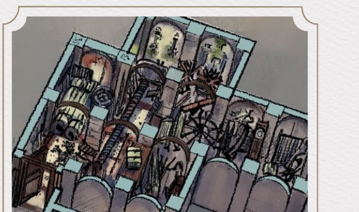

Это видение особенно жуткое. Тот, кто его наблюдает, обязан пройти проверку Рассудка (потеря 0/1d3 Рассудка).

## Базилика

Это помещение, превращённое в главный склад замка, примечательно многочисленными колоннами, соединёнными полукруглыми арками, и более высоким потолком. На стенах ещё можно различить остатки росписи и штукатурки римской эпохи, и пол сохранил изначальное мощение.

Внутри как попало свалено случайное собрание вещей и утвари. Трудно поверить, как всё это попало сюда по таким извилистым туннелям и лестницам: белая ванна; основания, рамы и матрасы кроватей в разной степени сохранности; огромная круглая металлическая люстра — разумеется, разобранная, — которая, вероятно, висела в главном вестибюле замка Дьюар в Средние века; старая и очень тяжёлая чугунная угольная печь с цилиндрическим корпусом и выступающей трубой; поршень гигантского винного пресса с крепким металлическим винтом длиной почти 5 м и толщиной с ногу; швейная машинка, которой, похоже, пользовались лишь однажды, и довольно ухоженная; диорама с подвижными марионетками — целый оркестр зверей, механизмы которых целиком заполняют ящик, где их хранят, и которая, должно быть, давно перестала работать; большое деревянное колесо с откидными пюпитрами, которое может держать открытыми до семи книг сразу; полдюжины зонтов для террасы; тканевая ширма с вышитым цветочным узором; кресло-качалка; нагревательное оборудование для воздушного шара; довольно большая модель голландской ветряной мельницы, которая, вероятно, задумывалась как садовое украшение; огромное переднее колесо велосипеда «пенни-фартинг»; ручной маслобойный пресс; разрозненные детали маятниковых часов; клейма для скота; ведёрко для шампанского на подставке, чтобы ставить его у стола или кровати; удочка — разумеется, без лески; очень шаткая на вид складная металлическая стремянка длиной около 4 м; цельная деревянная колыбель с погремушками и подвесками, которые хранятся внутри; одиночный цирковой батут — предшественник наших современных батутов, — у которого не хватает половины пружин; мимеограф; колокол с надписью «HMS Russell»; ксилофон; собачья цепь; остатки зелёно-жёлтого воздушного змея; точильный камень, которым можно пользоваться как есть, а при некоторой сноровке — подсоединить к приводному ремню швейной машинки, чтобы лучше точить ножи; двуручная пила для распиловки стволов; разобранный платяной шкаф, детали которого связаны верёвкой, чтобы не потерялись; маленькая грифельная доска; игрушечные санки, выкрашенные в красный; тележка с ржавой дырой в дне; складная сушилка для белья с несколькими деревянными прищепками, всё ещё висящими на проволоке; пресс для глажки газет; кормушка для голубей; неполный набор кеглей; оловянная чаша; пустые тыквы-горлянки с ремнями, чтобы служить поплавками для маленького ребёнка; простая конторка; ручная дрель; ожерелье из ракушек; дверной молоток в виде львиной головы и так далее.

### Находки: мозаики, фрески и заражённая рожь

Раздобыть металлические прутья и куски дерева в любой из этих комнат легко. Это не требует ни проверок, ни много времени. Поиск чего-то более определённого, например молотка и гвоздей, потребует проверки Внимания, сложность которой зависит от времени, потраченного на поиски. Если повторная проверка провалена, персонаж режется о какую-нибудь ржавую железку или надрывает спину, пытаясь поднять деревянную доску.

Не ограничивайтесь перечисленными для примера предметами, чтобы передать игровой группе ощущение беспорядка и подавленности. Кто знает, что ещё они могут найти в этих катакомбах?

Если вместо карьеры старьёвщиков сыщикам больше хочется попытать счастья в археологии, проверка Внимания позволит им понять, что на полу есть огромная мозаика, закрытая хламом и приспособлениями, которые лэрд складировал в этом подвале. Единственный способ хоть мельком её увидеть — сдвинуть часть этой мешанины вещей, на что уйдёт несколько часов и будет довольно шумно. Каждый сыщик имеет
