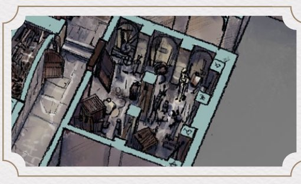

движение губ: в этих мёртвых землях стоит мёртвая тишина. Лицо жрицы раскрашено какой-то зелёной глиной, а её длинные волнистые чёрные волосы украшены цветами, водорослями, раковинами, кораллами и морскими звёздами.

Наконец жрица поворачивается спиной к собравшимся и вынимает из стены расшатанный кирпич. Из углубления она достаёт мешочек из грубой кожи и вынимает из него что-то похожее на маленькие, но очень длинные чёрные семена. Затем кладёт их в чашу из черепа животного, которую держит за рога, украшенные лентами и гирляндами, один из помощников, стоящий на коленях. Потом другой мужчина растирает зёрна костяным пестом и добавляет к смеси что-то вроде тёмного эля. После этого из черепа пьёт вся община. Пухлая дама принимает эликсир последней.

Приняв это причастие, все пускаются в неистовый пляс под ритм хлопков, на который жутко смотреть в тишине. Вскоре у одних начинаются судороги, другие корчатся от сильных спазмов в животе, а остальные ведут себя так, будто у них галлюцинации. Девочка, которой не больше семи-восьми лет, суёт руку в одну из жаровен, освещающих помещение, и хватает горящие угли. Все смеются, и девочка тоже, а огонь расползается по её коже, и из пламени вырывается густой чёрный дым, поглощающий её. На самом деле всех их поглощает это же чёрное облако, которое, кажется, живёт своей жизнью, забирая жизни своих почитателей, словно жертвы, и кладя конец иллюзии.

## Старый зерновой склад

В этом подвальном помещении скопилось изрядно хлама. Что-то разбросано по полу, что-то прислонено к стенам, а кое-что лежит в сундуках и деревянных ящиках.

С первого взгляда видно: груду старых чемоданов; прялку вроде той, что в «Спящей красавице» Перро; клёпки и металлические обручи от того, что когда-то было гигантским винным прессом, а теперь разобрано; остатки человеческого скелета, скреплённого проволокой, для изучения анатомии; сбрую человека-оркестра, от которой остались только барабан, крепящийся на спину, губная гармоника и тарелка; несколько деревянных скамей; вешалку для одежды; симпатичную настольную лампу в виде маяка; медную подставку для зонтов, зелёную, как салат; деревенскую метлу; изящный настольный держатель для писем; двух высушенных белок, закреплённых на сухой ветке внутри маленькой стеклянной витрины; треногу с грубым шатким топографическим инструментом; старый садовый шланг, свёрнутый в углу; пару садовых гномов, один из которых лишился головы; ворот с блоками, похожий на колодезный; явно испорченное конское седло; пюпитры на пол-оркестра; разбитое зеркало в полный рост, длинный гаситель для свечей и так далее.

Если немного порыться в этом барахле, можно найти изношенную деревянную вставную челюсть; военное знамя какого-то неизвестного полка шотландской пехоты; мандолину со всеми порванными струнами; гироскоп; набор пробойников для позументной отделки; пачку свечей; заплесневелый корсет; крикетную биту; ведро, полное негодных кистей; архаичный зоотроп, в котором видна скачущая лошадь; отсыревший старый фотоальбом; обломки старого щита; кусок красного коралла; коллекцию курительных трубок; деревянную чесалку для спины; снегоступы; сломанную модель корабля; побитый молью цилиндр, у которого кто-то вырвал подкладку; набор римских весов (в римском стиле, не подлинник — они явно новее); сложенный телескоп вместе с треногой; сложенную свинцовую табличку с проклятием, пробитую железным гвоздём, скорее всего с неразборчивой надписью, римской эпохи; маску для фехтования и очень грязный коровий колокольчик, при виде которого невольно задаёшься вопросом, зачем его хранят.

### Находки: учебная рапира и альбом

На полу за какими-то ящиками лежит, покрываясь пылью, рапира с затупленным концом, который можно заострить, отломив наконечник клещами. Найти её непросто: нужна трудная проверка Внимания. Заточенная, она наносит 1d6 + БкУ урона.

В альбоме — фотографии за последние тридцать лет, собрание снимков из некоторых путешествий лорда Дьюара. Здесь групповые фотографии экспедиций, доктора и Дава, но больше всего снимков разграбленных археологических сокровищ, добытых на охоте животных и местных зданий, интересных своей архитектурой. Есть и карты, нарисованные самим лордом Дьюаром, и другие памятные вещицы,
