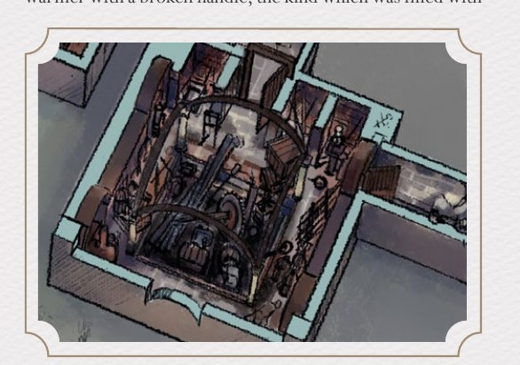

например засушенные цветы. Фотографии аккуратно датированы и подписаны, но никаких улик, которые помогли бы сыщикам разгадать тайну замка Дьюар, не дают. Ясно и то, что альбом охватывает не все экспедиции, в которых участвовал лэрд, и не все этапы тех экспедиций, что в нём есть.

### Отпечаток: находка одной из масок инков

Комнату освещают три масляные лампы. Всё в точности так, как сыщик это помнит (если он бывал здесь в нашем мире), ничего не изменилось.

Людей, держащих лампы, тот, кто наблюдает сцену, узнает без труда. Это не кто иные, как сэр Джаспер Брамли, мисс Глэдис Косгроув и её жених, мистер Артур Уилтшир. Они крадучись продвигаются вперёд, стараясь не издать ни звука, и, судя по состоянию их одежды, они уже долго роются в хламе этих подземных помещений.

Джаспер и Глэдис высоко поднимают свои лампы, чтобы света было как можно больше, а Артур своей лампой освещает углы, скрытые среди нагромождения ящиков. Время от времени они вдруг замирают, убавляют пламя, и один из них — или, вернее сказать, один из вас — выглядывает за приоткрытую дверь, чтобы убедиться, что никто не идёт.

В конце концов Джаспер достаёт со дна дорожного сундука, набитого всякой всячиной, цилиндр. Он ворошит в нём железки, но, похоже, ничего не привлекает его внимания. Он уже собирается бросить цилиндр обратно в кучу хлама, как вдруг его будто осеняет. Он переворачивает цилиндр и вытряхивает содержимое, и оно с грохотом падает — Артур и Глэдис неодобрительно на него смотрят, вероятно, из-за шума. Но Джаспер лишь улыбается, взвешивая цилиндр в руках, поднимает его обеими руками и рассматривает внимательнее. Он засовывает руку внутрь, будто измеряя глубину, и с улыбкой резко дёргает подкладку цилиндра; открывается потайное отделение, из которого он театрально, словно фокусник, вытаскивающий кролика, извлекает потрясающую золотую доколумбову маску.

Все трое забывают — вернее, вы забываете, — что нужно соблюдать тишину, и разражаются радостными криками, которых в нашей реальности не слышно, но которые легко представить по тому, как они прыгают. Глэдис даже поддаётся радостному порыву, хватает Джаспера за лицо обеими руками и внезапно целует его в губы, отчего дворянин несколько теряется. Лицо Артура вдруг становится серьёзным, и Глэдис пугается. Все трое стоят, глядя друг на друга, не говоря ни слова. Затем они разом снова разражаются неудержимым искренним хохотом, за которым следуют объятия втроём, полные нежности и, можно сказать, облегчения.

Под это ликующее празднество сцена исчезает — так же, как воспоминание о такой находке исчезло из памяти сыщика. Неужели мир мёртвых может проецировать не только воспоминания о далёком прошлом, но и о будущем, которому ещё только предстоит наступить? Конечно, нет, но именно эту мысль вам стоит попытаться внушить игрокам, чтобы отвлечь их внимание от настоящего объяснения.

## Подземные римские бани

Это помещение больше похоже на свалку, чем на склад. Несмотря на весь скопившийся здесь хлам, посреди комнаты ещё можно различить квадратную купальню римской постройки глубиной около 1,2 м, стены которой неровно покрыты пятнами жутковато-чернеющего тёмно-бурого пигмента.

В купальню грудой свалены: старомодное парикмахерское кресло; гигантское зубчатое приводное колесо на 5-метровом шесте, ось которого пересекают четыре железных прута, словно это штурвал корабля; остатки странной паровой машины с клапанами, трубами, шестернями и металлическими отсеками непонятного назначения — может быть, это старый котёл; огромная серая садовая ваза, покрытая грязью, такая большая, что в ней поместилось бы фруктовое дерево, — невольно задаёшься вопросом, как её сюда спустили и, главное, по какой непостижимой причине; совершенно разобранная детская коляска, ни одно колесо которой уже не круглое; помятые металлические судна и тазы; средневековое приспособление для витья верёвок; дверца топки паровоза с тремя вмятинами от пуль; остатки того, что когда-то было садовой статуей в человеческий рост, — постамент и ноги до колен; расщеплённое весло, источенное жучком, без пары; грелка для постели со сломанной ручкой — из тех, что наполняли

