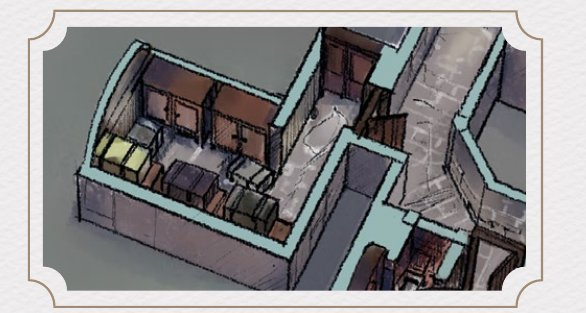

стене; граммофон, который ещё работает; куча банок с краской всех форм и размеров; каминные мехи; терракотовая фигурка Девы Марии без руки и большей части младенца; дагеротип с несколькими медными пластинками, теперь бесполезными; четыре ракетки для бадминтона и пара воланов; рюкзак из овчины и так далее.

Если осмотреть сундуки и ящики тщательнее, можно найти коллекцию бесполезных минералов, жеод и окаменелостей, рассортированную в деревянном ящике со множеством отделений; несколько готовален; нераспечатанную пачку палочек сургуча разных цветов; коробку с ёлочными украшениями; металлическую ступку с пестиком; футляр, полный перьев для каллиграфии; изношенный намордник маленькой собаки; бронзовый кран в удивительно хорошем состоянии; маленький браслет с колокольчиками; велосипедный клаксон со сгнившей резиновой грушей; половину чёрных железных ножниц; полупустой ящик с инструментами, с мешочками гвоздей, гаек и винтов разных размеров; серебряную чернильницу; старую масляную лампу; палитру художника; утку-манок; заплесневелую морскую губку; крошечную восьмиугольную коробочку с молочными зубами; соколиный клобучок и перчатку для соколиной охоты; дырявые сапоги для верховой езды с отстающими подошвами; ручную мороженицу; серебряный футляр для бальной книжки, инкрустированный драгоценными камнями; военный корнет с сурдиной; латунную коробку, полную очков и моноклей, большей частью целых; связку ключей, замков и висячих замков к которым, вероятно, уже не существует; кофемолку, которую не мешало бы хорошенько почистить; коробку, полную открыток и фотографий; сломанный бинокль; примитивную открывалку для консервов; очень грязную тряпичную куклу; охотничий рожок; набор бритв; крючок для застёгивания и расстёгивания железных пуговиц с ручкой из серебра и слоновой кости; маленькую шкатулку для рукоделия, обитую бархатом, с пяльцами внутри; и так далее.

### Находки: фотографии, серьга и потайная дверь

Чтобы наткнуться на фотографии, достаточно потратить немного времени на осмотр комнаты. Если игроки объявят, что сыщики рассматривают их внимательнее, они обнаружат, что на некоторых из них Артур и Джаспер — подростки. На обороте некоторых снимков записаны их имена и даты, но персонажи ничего не вспомнят ни о том, когда были сделаны снимки, ни о других людях или питомцах на них. Это, впрочем, вряд ли их потрясёт: наверняка до них давно уже дошло. Может быть, на фотографиях они играют с волчками, которые лежат в игровой комнате, или с какой-нибудь другой вещью, найденной во время поисков, которой, как им помнится, у них никогда не было. Эта находка станет куда более тревожной, если, в зависимости от того, на каком этапе находится история, они уже начали связывать происходящее или испытали тревожное чувство, что их воспоминания изменены: она укрепит их страхи и даже заставит пройти проверку Рассудка (потеря 0/1 Рассудка).

Фотографии помогут также опознать Фиделию (вернее, её платье и драгоценности), её мужа и так далее. Учтите, Хранитель, что фотография впервые была применена в 1830 году и начала входить в моду в 1860-х, то есть в нашей истории всего три десятилетия назад. Семья Дьюаров всегда была богата и интересовалась научными достижениями, так что не исключено, что существует первый и единственный портрет леди Эдны, лорда Оуэна и юного Амадеуса лет тринадцати-четырнадцати, сделанный незадолго до смерти отца (как и снимок Фиделии-младенца, который будет позже этого и находится в покоях лэрда), но это исключение: остальные снимки должны относиться примерно к тридцати годам после этих уникальных экземпляров. Значит, остальные фотографии Фиделии должны начинаться со времени её выхода в свет. Не должно быть и много фотографий Артура и Джаспера моложе тринадцати лет, хотя какая-нибудь могла быть сделана в другом месте и каким-то образом попасть в руки лэрда.

Тщательный обыск и трудный успех проверки Внимания позволят найти спрятанную в трещине одной из плиток пола серьгу исключительно высокого качества и ценности, которую сыщики смогут опознать как принадлежащую Фиделии Уилтшир (по фотографиям, воспоминаниям Артура, портрету в кабинете лэрда или по её вещам, найденным в спальне лорда Дьюара). Её денежной стоимости, в отличие от той, в которую оценили кольцо леди Дьюар, не хватит, чтобы избавить кого-либо из сыщиков от денежных затруднений; нужно просто дать понять, что это не грошовая безделушка, а ценная семейная реликвия.
