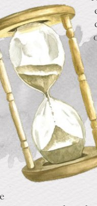

Рядом с ними стоит нечто вроде жуткой стойки для ужасных пыточных инструментов, которые теперь убраны в металлический комод.

Судя по всему, приспособлением пользовались много раз, но оно не обветшало и не принадлежит далёкой эпохе. Большинство предметов предназначено для того, чтобы причинять боль как можно эффективнее, но по возможности избегая ран и следов на жертве. Цель этих инструментов — не устрашение (а оно необходимо при допросах, и им обладают их более кровавые собратья), а практичная и действенная хирургия. Как правило, сыщики не будут иметь ни малейшего понятия, как обращаться с ними, чтобы использовать их возможности в полной мере, хотя всегда можно просто воткнуть их куда-нибудь самым острым концом.

Из этой камеры ведут три большие крипты, которые лорд Дьюар превратил в тюремные камеры. Во всех на входе решётки, на стенах — кандалы, походные койки и писсуар. Ими, судя по всему, пользовались не позднее чем в последний год, но по меньшей мере последнюю неделю в них, похоже, никого не было.

К дыбе прикреплён шнур звонка, который звонит в один из колокольчиков на кухне, в один в кабинете Дава и ещё в один в кабинете и спальне лорда Дьюара. Есть и механизм (сейчас отключённый), который заставляет те же колокольчики звенеть всякий раз, когда дёргают рычаг служебного лифта. Эта сигнализация используется, только когда в камерах сидят узники (то есть обычно нет), и обнаружить её почти невозможно (чрезвычайная проверка Внимания или Механики со штрафной костью).

Туннель налево ведёт к рыбным садкам и террариумам, которые тянутся под столовой, садами и оранжереей наверху. Наружу выходят вентиляционные ходы, через которые пчёлы вылетают из ульев и возвращаются, а иной отважный древесный змей по тем или иным случаям тоже сбегал по этим ходам из неволи. Разведению этих животных отведены три галереи. В ближайшей к служебному лифту шесть бассейнов, вырубленных прямо в скале; в них живут электрические угри и сомы. Эти существа способны ударить сильным электрическим разрядом, наносящим 1 очко урона. Их чешуя совпадает с той, что сыщики могли найти в санатории.

Бассейны закрыты деревянными досками, но под ними слышен тревожный плеск существ. Рыболовные сети и вёдра, нужные для переноски рыб, сложены в глубине галереи, у разрушенной лестницы, ведущей к старому зерновому складу.

*Прим. перев.: так в оригинале. На с. 112 обрушенная лестница от рыбных садков ведёт к римским баням (и в описании бань, с. 108, есть арка с обрушенной лестницей вниз); вероятно, и здесь имеются в виду подземные римские бани.*

Посреди помещения стоит передвижной кран, который с помощью системы блоков может опустить в любой из шести садков большую ржавую металлическую клетку. Клетка висит на четырёх цепях, расположена горизонтально и имеет около 2 м в длину, 60 см в высоту и 1 м в ширину. На её дверце крепкий висячий замок, и она явно сделана для того, чтобы посадить туда человека.

Вторая крипта отведена под террариумы. В них в основном змеи, но есть и тарантулы, сколопендры и скорпионы, и часто животное трудно разглядеть, потому что оно сливается с воссозданной внутри террариума природной средой. У большинства стеклянные стенки, но есть и клетки из металлической сетки. В углу — набор корзин и контейнеров для переноски, а также щипцы разных размеров и крюки для обращения с животными. На мелком песке, покрывающем пол, можно заметить борозды змеи, которая, возможно, сбежала, — это наполнит сыщиков тревогой.

Третья и последняя пещера замурована цементной стеной с металлической дверью. Рядом стоит шкаф с тремя костюмами пасечника и всеми прочими принадлежностями этого ремесла (дымари, лопатки, щётки и т. д.). Если приложить ухо к двери, которая, разумеется, заперта, легко услышать, как по ту сторону жужжат пчёлы.

Если сыщики попытаются вскрыть замок или заглянуть в замочную скважину, маленькая пчёлка (вероятно, напуганная больше, чем они сами) застанет их врасплох, вылетев как раз из этого отверстия, и хорошенько их напугает.

Миновав дверь, попадаешь в большую подземную камеру, где рядами стоят две дюжины ульев. В потолке — ходы, через которые в зависимости от времени суток пробивается немного света и через которые пчёлы снуют туда и обратно в неустанном труде. Есть система рычагов, которой можно открывать и закрывать заслонки этих ходов, — их назначение сыщики быстро поймут, если снаружи светит солнце.

### Находки: ещё одна музыкальная шкатулка, братская могила и загадочные инициалы

Если персонажи тщательно обыщут пыточную, они без всяких проверок найдут маленькую музыкальную шкатулку, которую Эдна подарила Фиделии (на самом деле — ещё одну из
