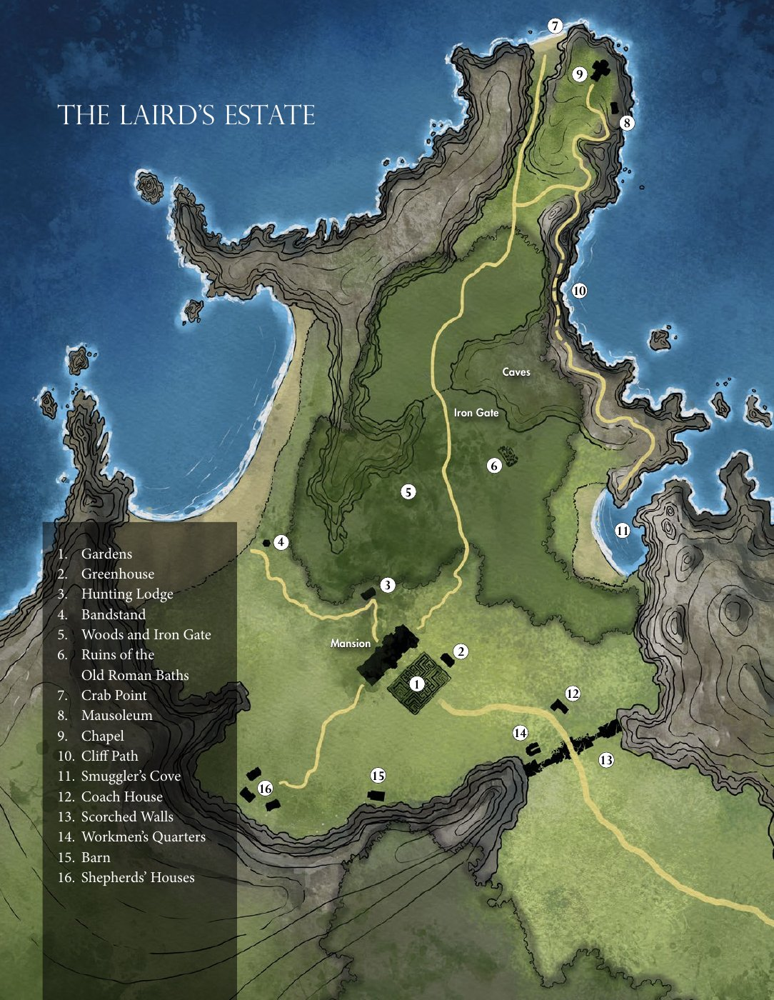

**Поместье лэрда**

1. Сады
2. Оранжерея
3. Охотничий домик
4. Музыкальная беседка
5. Лес и железные ворота
6. Руины старых римских бань
7. Крабовый мыс
8. Мавзолей
9. Часовня
10. Тропа над обрывом
11. Бухта Контрабандистов
12. Каретный сарай
13. Опалённые стены
14. Бараки рабочих
15. Амбар
16. Дома пастухов

*Прочие подписи на карте: «Особняк» (Mansion), «Железные ворота» (Iron Gate), «Пещеры» (Caves).*
