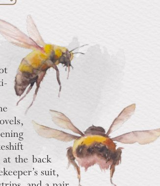

Его фигура начинает распадаться и растворяется, за ней — фигура Глэдис. Призрак воспоминания об Артуре, застывшем посреди сада, как мраморная статуя, исчезает последним.

Нечего и говорить, что никто из участников этого эпизода его не помнит. Более того, он прямо противоречит предысториям в листах персонажей, где ясно сказано, что Артур и Глэдис познакомились в театрах Ковент-Гардена в Лондоне. Если игроки не спросят, ничего им не говорите.

А если спросят — тоже не говорите.

## Оранжерея

Это сооружение из кованого железа и стекла сейчас скорее садовый сарай для инструментов, чем настоящая оранжерея. Стёкла, некоторые из которых разбиты, грязные и мутные, а металлическому каркасу не помешал бы свежий слой зелёной краски, чтобы скрыть расползающиеся пятна ржавчины — свидетельство плачевной заброшенности.

Предполагается, что за домиком и садами ухаживают Шерманы, но, хотя изредка они и берутся за дело, обычно от этой обязанности увиливают. Особняк и его обитатели их пугают, и им неуютно работать так близко от главного здания.

Помимо редких видов растений, уже упомянутых в описании садов, в оранжерее живут всевозможные яркие экзотические птицы: ары, попугаи, волнистые попугайчики, длиннохвостые попугаи, щеглы, какаду, колибри, радужные овсянки и длинный список прочих, названий которых сыщики не знают.

Некоторые из этих птиц умеют говорить, вернее, повторять услышанное — и некоторые слова, которые они произносят, могут очень встревожить. Лорд Дьюар провёл бо́льшую часть траура, запершись в этом здании и рыдая и стеная в одиночестве, и почти каждое пернатое создание, способное на это, без конца повторяет один и тот же припев: «Все мертвы! Все мертвы!»

Снаружи сооружения стоит ручной водяной насос, который можно использовать как гидрант, чтобы поливать и сады, и растения в оранжерее.

### Находки: вентиляционные ходы ульев

Несмотря на несоразмерное количество птиц, пчёл в оранжерее тоже хватает. Если сыщики осмотрят окрестности и пройдут проверку Внимания или Слуха (чтобы пойти на жужжание), они обнаружат в полу загадочные металлические решётки, через которые снуют эти насекомые. Похоже, их ульи под землёй.

Отверстия слишком малы, чтобы в них пролез взрослый, даже если снять решётку, но их можно расширить, откалывая камень вокруг. Сделать это незаметно трудно, но не невозможно — особенно если сыщики устроят отвлекающий манёвр.

Если обыскать остальную часть сарая, сыщики найдут лопаты, секаторы и другие садовые инструменты, которые можно использовать как подручное оружие. Кроме того, в глубине шкафа они обнаружат рваный, потрёпанный костюм пасечника, который легко разорвать на полосы, и пару крепких рабочих перчаток в довольно хорошем состоянии.

### Отпечаток: Фиделия отвергает извинения Джонатана

Когда сцена начинает обретать форму, оранжерея вновь обретает былое великолепие. Зелёная краска сарая становится ярче, стёкла срастаются и очищаются от грязи, увядшие цветы сменяются пышными зелёными растениями, а разбросанные инструменты исчезают с середины дорожки.

В здании работает молодая женщина в изысканно расшитом платье цвета слоновой кости. Если наблюдающий сцену видел картину, фотографию или другой отпечаток, где она появляется, он сразу узнает Фиделию Уилтшир.

Хотя выражение её лица серьёзно и сосредоточено на деле, в нём есть оттенок меланхолии. Проблеск внутреннего страдания, от которого садовая работа ненадолго отвлекает. Быть может, даже оттенок гнева — заметный по тому, как она привязывает стебель одного из растений к тростинке, которая будет направлять его рост, чуть сильнее, чем нужно.

В этот момент в оранжерею входит причина её разочарования. Это Джонатан Уилтшир, отец Артура, которого узнать, возможно, несколько труднее.

Хотя он одет в элегантный деловой костюм, ботинки у него старые и стоптанные. Держа за спиной букет роз, он осторожно приближается, будто не решаясь потревожить жену.

Тот малый покой, который Фиделия, возможно, обрела за садовой работой, исчезает, едва она замечает присутствие Джонатана. Её прекрасное лицо выдаёт смятение, но ей удаётся сохранить самообладание.

Уилтшир нерешительно подходит к ней, жестикулируя. Сыщик не слышит, что он говорит, но по языку тела ясно, что он пытается жалобно извиниться. Фиделия не отвечает, и выражение её лица не меняется. Она дышит глубоко и медленно. Слова мужчины её, похоже, не трогают.

Тогда, опустившись на одно колено, Джонатан достаёт из-за спины букет роз и протягивает его Фиделии.
