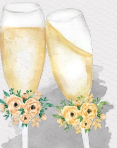

ни судьи, только двое мужчин, которые встают спиной к спине, а затем отсчитывают по десять шагов в противоположные стороны. Они оборачиваются и стреляют одновременно, и их фигуры окутывает дым. Хотя одновременные выстрелы в мире духов звучат приглушённо, вспышки выстрелов всё же видны.

Один из двух джентльменов шатается и падает на землю, смертельно раненный. Это Артур Уилтшир.

Сцена рассеивается вместе с пороховым дымом.

Та ли это дуэль, на которой Артур дрался в Лондоне? Сыщик не может знать наверняка, но многое, похоже, не сходится — не в последнюю очередь то, что его убили, а это едва ли мелочь.

## Музыкальная беседка

Если идти по тропе к пляжу, придёшь к этой деревянной музыкальной беседке, стоящей прямо там, где начинается мелкий песок, и неподалёку от опушки леса. Выкрашенная в белый отделка выделяется на фоне досок крыши, окрашенных в глубокий синий цвет лазурита.

Бока сооружения увиты вьющимися растениями, и кто-то потрудился украсить некоторые перила и столбики гирляндами из сплетённых полевых цветов.

Днём отсюда открывается великолепный вид на побережье, а на закате здесь бывают восхитительные зрелища. Ночью звёздное небо бесконечно простирается до самого горизонта.

Отсюда сыщики могут увидеть, как сёстры Шерман нагишом резвятся в прибое или даже исполняют в самой беседке какой-то странный местный народный танец. Если они в воде, то попытаются завлечь сыщиков своими эротическими играми; если им удастся привлечь их внимание и подманить поближе, они убегут в лес и в конце концов приведут сыщиков к древним руинам. Они постараются бежать ровно так быстро, чтобы оставаться впереди, но и не настолько, чтобы сыщики совсем их потеряли.

### Находки: осквернённое сердце

Проверка Внимания при беглом осмотре места откроет на одном из столбиков вырезанное сердце с инициалами, которые теперь почти невозможно разобрать: кто-то выскоблил дерево вокруг них. Если сыщики не будут торопиться и пройдут проверку ИНТ, они смогут определить, что буквы первого имени состояли из вертикальных и наклонных линий (V, Y, X?), а второго — имели округлые очертания (Q, O, S?).

Повреждения закрашены белым (краска покрывает царапины и борозды), а значит, этому вандализму по меньшей мере несколько лет, о чём можно судить и по скопившейся грязи. Вы, наверное, уже догадались, что инициалы были AW и GC — разумеется, оригиналов, а не их копий, — и что человеком, который в приступе ярости пытался их уничтожить, был Джаспер Брамли. Разумеется, сыщики об этом ничего не помнят.

### Отпечаток: одна свадьба тянет за собой другую

На волнах играет сумеречный свет. Пляж полон босых людей — судя по нарядам, высокого положения, — которые собрались вокруг костров и факелов. Между ними снуют слуги с подносами, уставленными бокалами шампанского и изысканными канапе. Многие гости в старомодных военных мундирах.

Всё внимание приковано к музыкальной беседке, чьи доски и отделка ещё не покрашены и сохраняют естественный серый цвет лакированного дерева. В центре — блестящий чёрный рояль, который сыщики, вероятно, помнят по музыкальному салону особняка.

По ступеням беседки поднимается пара. На нём традиционный красный британский мундир, увешанный медалями, и светлые брюки, заправленные в высокие чёрные сапоги для верховой езды. Она одета невестой и сияет. Это лорд Оуэн и леди Эдна, которые, судя по всему, только что поженились.

Лорд Оуэн произносит несколько слов, опираясь одной рукой на перила, а другой поднимая бокал для тоста. Его речь встречают приглушёнными в мире за завесой аплодисментами и возгласами. Затем он указывает на жену, которой устраивают ещё одну беззвучную овацию, пока она делает изящный реверанс. Потом лорд Оуэн спускается со сцены к своим товарищам по оружию, которые приветствуют его хлопками по спине.

Тем временем леди Эдна садится за рояль и начинает играть. Сцена словно начинает светиться ярче. Сыщик не слышит ни одной ноты, но всякий раз, как раскрасневшаяся новобрачная касается клавиши, кто-нибудь из гостей или слуг гаснет, и выступление становится всё более камерным. Мало-помалу исчезают все присутствующие, затем окружающая обстановка, сменяющаяся абсолютной чернотой, затем и сама беседка. Остаются только леди Эдна, лорд Оуэн и трое-четверо их ближайших друзей. Затем начинают исчезать и они, а свет, источник которого невозможно определить, купает их в своих золотых лучах. Теперь остаются лишь невеста, лорд Оуэн и тот, кто, кажется,

