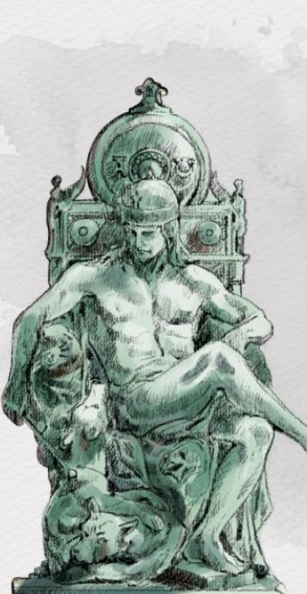

плачущего ангела; у четвёртой — голова деревянной Девы Марии; а у пятой головы нет вовсе.

По правде говоря, она не единственная безголовая статуя. Многие другие тоже лишились голов за эти годы, но в тех случаях мраморный обломок по крайней мере можно найти у ног скульптуры. Более того, учитывая, как грубо головы отбивали и меняли, удивительно, что у стольких изваяний они вообще есть.

Если пройтись среди руин, можно увидеть остатки древних купален, сегодня целиком заросших густой чащей. В одном из мест, ещё окаймлённом одним из самых длинных уцелевших отрезков стены, между четырьмя колоннами, обломанными на разной высоте, по одной в каждом углу, стоит огромный каменный алтарь.

### Находки: алтарь пастушек и вход в пещеры

Беглый осмотр откроет верёвки, привязанные к каждой из четырёх колонн. Хотя они грубо сплетены из какого-то растительного волокна, они не древние и, несмотря на небрежную работу, не уступают в прочности любой покупной верёвке. Судя по их длине и размерам места, назначение их очевидно: привязать человека к алтарю, растянув его руки и ноги. Следов крови на каменной поверхности нет — по крайней мере, свежих.

Чтобы найти вход в пещеры, нужен трудный успех проверки Внимания, если сыщики просто обыскивают место, или обычный, если они ищут именно в банях, а это, в свою очередь, требует проверок ЛВК (или Выживания), чтобы не пораниться о заросли (1d3−1 пунктов здоровья). Кожаные сапоги, перчатки и фартуки тоже позволяют избежать этой опасности.

Вход спрятан за зарослями ежевики, но кусты можно сравнительно легко раздвинуть палкой или если знать, за что тянуть. Хотя вход довольно мал, в него может проползти человек. Туннель (старый римский водовод) тянется на некоторое расстояние, пока не выходит в естественную пещеру с сырым полом в мелких лужах. Успешная проверка Науки (геологии) покажет, что столетия назад естественный обвал завалил источник, из которого когда-то текли сюда термальные воды, вероятно направив его к особняку. В пещеру ещё просачивается немного влаги, но её не хватает, чтобы наполнить старые бани.

В пещеру ведут и другие входы, туннели которых ведут в Бухту Контрабандистов и на другую сторону железных ворот.

### Отпечаток: первые ритуалы лорда Дьюара

Сцена начинает материализоваться в свете холодного утра. Чья-то фигура, шатаясь, бредёт по мокрой земле к римским руинам, перемазанная грязью и травой после нескольких падений. Это лорд Дьюар, и он, похоже, мертвецки пьян или даже не в своём уме. Трудно поверить, что одно лишь злоупотребление вином может объяснить его поведение.

Вместо трости он опирается на старую лопату, а в другой руке несёт флягу, из которой на ходу отхлёбывает. За спиной у него ранец, который, судя по его потрёпанному виду, несомненно, сослужил ему службу не в одной экспедиции.

Явно возбуждённый, лэрд огрызается на статуи, хотя мы не слышим ни того, что он им говорит, ни их ответа. Надо полагать, они молчат, как и подобает мраморным скульптурам, сколько их ни брани.

Он с тяжёлым стуком бросает ранец на раскисшую землю и нерешительно начинает доставать из него несколько золотых доколумбовых масок. Время от времени какая-нибудь выскальзывает и падает в грязь, но доктора это, похоже, не слишком заботит.

Он прилаживает их, как может, на лица шести из двенадцати статуй, выбранных по какому-то признаку, который уже не вполне ясен. Затем роется в карманах и достаёт маленький кожаный мешочек, из которого вынимает несколько удлинённых чёрных семян. Он кладёт по семени в рот каждой из шести статуй, а потом подносит флягу к их мраморным губам, словно помогая запить. Скульптуры, будучи скульптурами, не слишком стараются не пролить напиток, что только сильнее его бесит.

