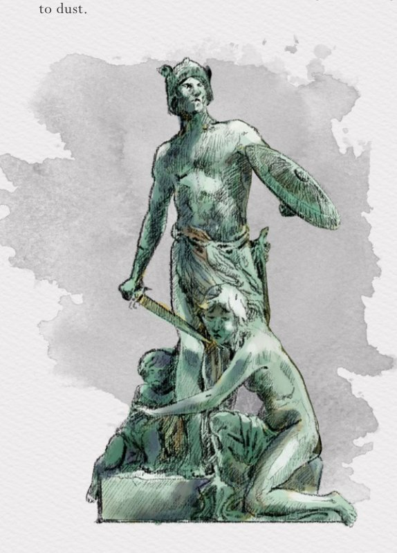

Он машет руками, прыгает и совершает череду судорожных движений, которые легко принять за какой-то племенной танец. Он мажет грязью лицо, потом всё тело, но ничего не происходит.

Раздосадованный, лорд Дьюар падает на колени, едва не плача. Дыхание его учащается, кровь приливает к лицу. В мгновение ока он хватает лопату и со страшной силой бьёт ею по шее одной из статуй, которая трескается от свирепого удара. Сила, которую проявляет лэрд, намного превосходит то, чего можно ожидать от человека его преклонного возраста, даже с учётом его богатого приключениями прошлого.

Доктор совершенно вне себя. Орудуя лопатой, он осыпает статуи ударами, пока пять голов не падают на землю. Остаётся только одна — та, что в маске, которую, как знают сыщики, если они изучали этот вопрос или видели отпечаток в игровой комнате (с. 54), нельзя связать ни с одним из богов инков. Он поднимает лопату и, словно сражённый на месте испепеляющим взглядом скульптуры, рассыпается пеплом.

На самом деле исчезает, рассыпаясь в прах, вся иллюзия.

## Крабовый мыс

На этот крохотный пляж попадаешь по узкому ущелью, проходящему между скал этого крутого выступа. У кромки воды ещё видны остатки неприметной деревянной пристани, где когда-то швартовались небольшие лодки контрабандистов, — теперь это лишь несколько разрозненных столбов.

Волны яростно разбиваются о скалы, так что земля здесь всегда мокрая и скользкая. Поэтому есть немалый риск поскользнуться, разбить голову и утонуть или истечь кровью.

### Находки: дыхало и следы рыбака

Как и в Бухте Контрабандистов (см. ниже), здесь можно найти следы пребывания Питера Хелма (обугленные остатки старого костра, выброшенные панцири крабов и т. д.) или даже самого рыбака, который уплывёт на своей потрёпанной лодке, если сыщики застанут его врасплох.

В отлив можно добраться — правда, лишь бредя по колено в воде — до узкой морской пещеры, соединённой с дыхалом на вершине утёса. Когда-то кто-то потрудился прибить к стенке природной трубы, ведущей на вершину утёса, металлическую лестницу — теперь ржавую и опасно шаткую.

Пристань нарочно построили рядом с дыхалом, чтобы его было легче заметить и до него добраться.

Все эти находки можно сделать без всяких проверок — достаточно набраться смелости войти в эти опасные галереи. Если прилив начнётся, пока персонажи в пещере, считай, они покойники, так что лучше уйти при первом же признаке опасности. Прилив и отлив сменяются каждые шесть часов.

### Отпечаток-выход: утянутый в глубины психики

Прежде чем что-либо увидеть, сыщик услышит голос — мужской или женский, в зависимости от его пола, — который изо всех сил отчаянно зовёт на помощь. Это неслыханно в мире духов, который неизменно окутан могильной тишиной.

Затем сыщик увидит, как в море проступает фигура — фигура тонущего человека. Тело швыряют волны, и черт лица сквозь пену не разобрать. Вскоре голова перестаёт выныривать за воздухом, и лишь рука изредка показывается над поверхностью.

Бросится ли сыщик в воду на помощь или будет и дальше смотреть с берега, вскоре он потеряет барахтающуюся фигуру из виду. Как раз когда кажется, что человек пал жертвой жестокости моря, две руки хватают сыщика за лодыжки и утягивают
