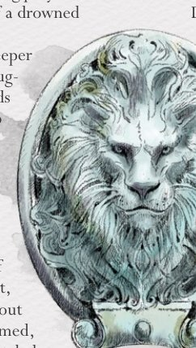

под воду. Если персонаж бросился в воду, он ничего не увидит — лишь почувствует, как что-то хватает его за ноги и тянет. Если он остался на берегу, то увидит, как руки выметнулись из воды, но не сможет избежать участи жертвы. Сыщику покажется, что это руки утопленника — бледные, в синяках.

Свет меркнет по мере того, как персонаж погружается всё глубже в море, как бы отчаянно он ни пытался выплыть на поверхность. Вцепившиеся в него руки медленно карабкаются вверх по телу сыщика, и, хотя тьма сгущается, образ того, кто тянет его вниз, как ни парадоксально, становится всё отчётливее.

Когда чернота становится полной, тот, кто тащит его на самое, кажется, дно океана, добирается до пояса сыщика, и персонаж теперь ясно различает его лицо. Хотя оно в синяках, обезображено и иссечено шрамами, он не может его не узнать.

Ибо это его собственное лицо.

С этим жутким осознанием мир вокруг меркнет, и он перестаёт дышать.

Придя в сознание, он увидит, как Дав промокает ему лицо мокрой тряпкой, а доктор Дьюар и сиделка Реддинг пытаются его оживить.

На лодыжках он увидит воспалённые красные ссадины от ремней, которыми он пристёгнут к машине и против которых яростно боролся.

И с этим он проснётся, кашляя и отплёвываясь, снова среди живых.

## Мавзолей

Если свернуть на крутую ветку лесной тропы, ведущую к обрывам, вскоре придёшь к ещё одной развилке. Если идти направо, поднимешься на тропу вдоль гребня отвесного обрыва — уже отсюда чувствуется, что по ней небезопасно идти, — которая, похоже, ведёт на вершину утёсов, окружающих Бухту Контрабандистов. Если идти налево, придёшь к мавзолею семьи Дьюаров, а за ним — к часовне.

Внушительная усыпальница построена из серого известняка, который с годами приобрёл голубоватый оттенок, в откровенно ионическом стиле. Семь ступеней ведут ко входу из массивного бразильского эбенового дерева, окованного сталью и, разумеется, запертого. На полированном чёрном итальянском алебастре фронтона высечен фамильный герб: коронованный крылатый лев, вставший на дыбы. Во фризе есть и латинская надпись: «POST SACRIFICIUM BENE MERITAE REQUIEM · ACCIPE LUX AUREA COELI CLEMENTIS DEI DONA UOTUMQUE PERENNE · TIBI GLORIA PIA DEI IN SAECULA SAECULORUM», что примерно значит: «После жертвы — заслуженный покой. Прими золотой свет небес, дары и вечные благословения милосердного Бога. Тебе благочестивая слава Божия во веки веков». Четыре угла кровли венчают изящные акротерии в виде лежащих львов.

Рядом со склепом — небольшое кладбище, усеянное надгробиями и крестами, восходящими по меньшей мере ко времени постройки особняка, если не раньше. На кладбище похоронены главным образом многие слуги, работавшие в замке Дьюар, а также некоторые другие работники поместья. Многие другие, разумеется, предпочли, чтобы их останки вернули туда, где они родились. Дорожку к ступеням мавзолея обрамляют две статуи плачущих ангелов, закрывающих лица руками, — или, по крайней мере, так кажется по положению их рук, потому что обе фигуры жестоко обезглавлены.

### Находки: недостающие кости, кости, которых здесь быть не должно, и золотая маска

Сыщики могут осмотреть и могилы на кладбище под открытым небом, и гробницы в семейной усыпальнице, если сумеют попасть в мавзолей. Лорд Дьюар не будет возражать одолжить им ключ, если они попросят, даже если подозревает, что они собираются осквернить гробницы в поисках доколумбова сокровища, которое, как они думают, он прячет. Если ключа у них нет, можно попытаться вскрыть замок. Это непросто, но в таком уединённом месте их никто не будет торопить. Не грозит им и опасность быть обнаруженными (оттуда, где они находятся, любого идущего видно задолго до того, как он подойдёт). Так что, если они согласятся потратить на это бо́льшую часть утра, дайте им бонусную кость. Выбить саму дверь практически невозможно. Для этого понадобились бы хорошие инструменты (вроде тех, что можно найти в бараках рабочих) и много часов работы.

О могилах под открытым небом сказать больше почти нечего. В основном они принадлежат слугам лэрда, и ничего особенно примечательного в них нет. Здесь же были похоронены (а позже эксгумированы) тела Артура, Глэдис и Джаспера, но от этого не осталось и следа. Место, где
