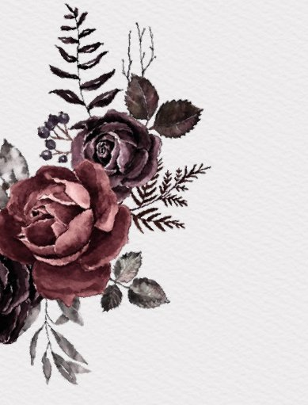

### Отпечаток: заупокойная месса по Фиделии

Небо затянуто тучами, и в церкви темно; её освещают лишь свечи, оставленные в приношение изваяниям святых и Девы.

Первым материализуется образ Фиделии Уилтшир перед алтарём — только это не она, а её портрет. Та самая картина, что висит в кабинете лорда Дьюара.

Рама украшена белыми цветами, и повсюду громоздятся похоронные венки. Гроба нет, потому что, по-видимому, после пожара спасать было нечего. Так что это скорее не погребение, а служба за упокой души дорогой покойницы.

Часовня начинает заполняться призрачными фигурами. Они не входят, а материализуются прямо на местах: богатые люди сидят на скамьях, слуги стоят в глубине нефа.

Лорд Дьюар, леди Эдна и Артур Уилтшир, разумеется, сидят на передних скамьях. По другую сторону прохода, рядом с молодым человеком всего на несколько лет старше её, держа его за руку, сидит мисс Глэдис Косгроув, то и дело поглядывая на своего жениха. Позади лэрда и его семьи — лорд Эдмунд Брамли, его гораздо более молодая вторая жена и его сын Джаспер, который сидит прямо за Артуром и время от времени мягко, утешающе кладёт руку ему на плечо.

Если сцену наблюдает Глэдис, она узнает в сидящем рядом с ней мужчине своего брата Сэмюэла. Если Артур или Джаспер, они не смогут его опознать, но могут вспомнить его как молодого человека из отпечатков у железных ворот (с. 122) и в охотничьем домике (с. 119), если видели их или им их описали. Судя по его близости с Глэдис — большей, чем можно было бы ожидать даже от жениха (а им, как мы знаем, он быть не может), — и по их внешнему сходству, это должен быть близкий родственник. Более того, судя по возрасту — разница между ними не больше трёх-четырёх лет, — это может быть только один из братьев юной сопрано.

Если Глэдис уже видела этого молодого человека, хотя и не узнала, в отпечатке у железных ворот или в охотничьем домике, теперь она поймёт, что это был её брат. Объясните игроку этой сыщицы, что это чувство похоже на сон, где, например, ты в церкви, но почему-то знаешь, что это твой дом, или говоришь с деревом, о котором знаешь, что на самом деле это твой отец, — только наоборот. Тот молодой человек был её братом, но, глядя на сцену, она почему-то этого не знала, — только это был не сон, а отпечаток. Но кто знает, какие различия и сходства могут быть между миром мёртвых и миром снов?

Священник начинает говорить, хотя невозможно расслышать, что он говорит. Вдруг тучи расходятся, и свет льётся сквозь окно-розу церкви, освещая раму картины сзади и окружая портрет Фиделии святым ореолом. Солнечные лучи становятся всё ярче и ярче, пока сыщику не приходится зажмуриться от слепящего света. Когда он наконец может снова открыть глаза, оказывается, что сцена полностью исчезла.

## Тропа над обрывом

Если свернуть на ветку, противоположную той, что ведёт к мавзолею, выйдешь на узкую тропу, огибающую край утёса. Бо́льшая часть извилистой тропы идёт по гребню, хотя иногда она отходит вглубь, чтобы обойти глубокую расселину в скале. Море яростно бьётся о мокрые, покрытые солью пропасти. Чайки и глупыши свили гнёзда на склоне утёса и, вероятно, будут донимать сыщиков, если те пойдут по этой тропе, — особенно если кто-то из них сорвётся с края. Скорее всего, это случится, только если они оступятся и упадут, но птицы решат, что те пытаются украсть их яйца, и это усугубит и без того опасное положение незадачливого персонажа.

Чтобы пройти по этим скалам, нужно пройти проверку ЛВК (или проверку Лазания с бонусной костью), иначе упадёшь и получишь 1d6 очков урона, — и это при условии, что сыщики продвигаются осторожно, средь бела дня и в хорошую погоду. Если персонаж провалит проверку и сорвётся с края обрыва, ему удастся ухватиться за неглубокий уступ и повиснуть над пропастью (если только это не была повторная проверка или крах). В этом случае товарищам придётся попытаться его спасти, пока морские птицы яростно его клюют.

