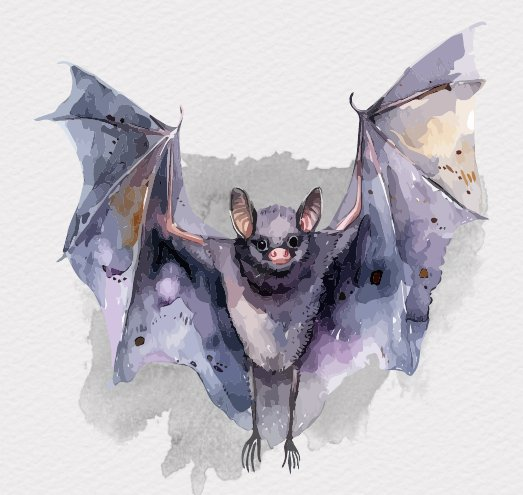

человечков-палочек, держащихся за руки, инициалы JB и AW, чтобы наколдовать запретное желание, навсегда недостижимое.

Если сыщики исследуют устья других галерей, успешная проверка Внимания, Слуха, Естествознания или Чтения следов (или изобретательные уловки вроде того, чтобы поднести свечу к туннелям и уловить сквозняк) откроет проходимый путь. Важной подсказкой станут следы гуано летучих мышей, живущих в пещере, и звуки, которые они могут издавать. Если сыщики решат пройти в эту расселину, они вспугнут летучих мышей, которые всей стаей вырвутся из туннеля. Хотя вреда это не причинит, напугает их изрядно.

Путь заканчивается камерой с лужами тёплой воды, из которой выходят ещё два туннеля: один ведёт к древним римским руинам, другой — в галерею, выводящую на другую сторону лесных ворот (см. раздел «Руины старых римских бань»).

Кроме того, успешная проверка Внимания или Лазания при осмотре утёсов откроет природную лестницу, ведущую на вершину обрыва (см. предыдущее место). Как уже говорилось, чтобы подняться по ней, нужно пройти проверку Лазания со штрафной костью.

### Отпечаток: пробуждение желания Джаспера

На пляже материализуются три мужские фигуры. Младшему, лет тринадцати-четырнадцати, — Артур Уилтшир. Второй — Джаспер Брамли, ему около шестнадцати. Третий призрак — молодой человек немногим старше тридцати. Это рыбак Питер Хелм; если тот, кто наблюдает сцену, имел случай пообщаться с ним и может его узнать, он покажется добрыми двадцатью годами моложе, чем сейчас.

Судя по загару, сейчас разгар лета. Трое друзей купаются нагишом и прыгают в море с вершин скал.

Артур, самоуверенный как всегда, красуется на одном из выступов, а Джаспер смотрит на него из воды с неудержимым томлением. Его рука, словно сама по себе, опускается к паху, чуть ниже поверхности воды. Юный Артур этого движения совершенно не замечает, но взрослый замечает и подозрительно смотрит на него.

Вдруг Джаспер понимает, что за ним наблюдают. Хотя ничего непоправимого, что могло бы его выдать, не произошло, он заметно краснеет. Смутившись, он выбирается из воды, стараясь держаться спиной к двум товарищам по купанию. Однако тот, кто наблюдает воспоминание, сможет увидеть безошибочные признаки возбуждения, которое аристократ пытается скрыть от друзей.

Джаспер бежит к одной из трещин в каменных стенах, обрамляющих бухту, и проскальзывает внутрь, буквально исполняя своё желание провалиться сквозь землю. Артур на мгновение озадачен, но быстро приходит в себя и пожимает плечами, отмахиваясь от случившегося. Затем он прыгает, ныряя головой вперёд в воду. Второй мужчина качает головой, на его лице проступает улыбка; затем он выходит из воды, растягивается на песке и подставляет кожу солнечным лучам, чтобы обсохнуть.

Артур, весь мокрый, карабкается обратно на скалу и готовится прыгнуть снова. В этот миг его фигура растворяется на ветру, как пена отступающей волны, вместе с остальными элементами видения.

Нечего и говорить, что ни Джаспер, ни Артур не вспомнят этого эпизода из своего прошлого.

## Каретный сарай

Одно крыло этого Г-образного здания отведено под конюшни, где лошади лэрда теснятся в узких стойлах. До пожара главные конюшни располагались у стен. Хотя сегодня доктор держит гораздо меньше лошадей, нынешнее устройство всё равно не оставляет много свободного места. Сейчас в замке Дьюар двадцать лошадей: две кобылы, величественный жеребец, два молодых жеребёнка, шесть тяжеловозов, четыре иноходца, четыре резвые верховые лошади и одна усталая старая кляча.

Во втором крыле здания — мастерская, где, можно сказать, пустили корни современный родстер (его внутренности постоянно выставлены напоказ в нескончаемом ремонте) и разнообразные сёдла, ярма и прочие предметы, нужные для ухода за конюшней и ремонта экипажей. К ней примыкает собственно каретный сарай, где стоят шаткая чёрная карета с гербом семьи Дьюаров и открытая телега, на которой привозят припасы из деревни.
