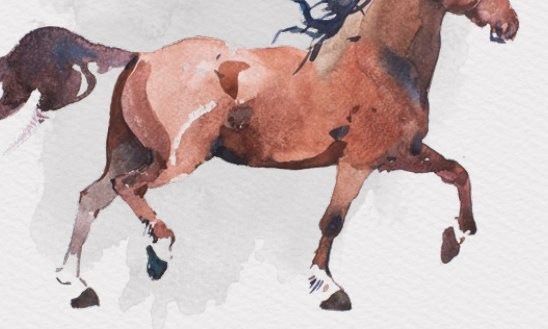

В центральном пространстве, которое с двух сторон ограничивают постройки каретного сарая, устроен открытый манеж для выездки и верховой езды.

Хотя деревянное здание построено сравнительно недавно, содержится оно плохо. Гаррет, конюх, который отвечает за его содержание и за уход за лошадьми, живёт и спит в одном из углов. По всему сараю разбросаны следы пребывания конюха — в основном пустые стеклянные бутылки.

### Находки: спиртное, формы для масок, сломанный автомобиль и листовка мюзикла

Если персонажи тщательно обыщут конюшенное крыло и пройдут проверки Внимания и Обращения с животными, они смогут найти запас спиртного Гаррета. Он спрятан в тайнике под соломой в деннике жеребца. Могучее животное никого, кроме своего конюха, к себе не подпускает, поэтому заодно сторожит жидкое сокровище Гаррета. Если сыщики откроют бутылку, чтобы понюхать или попробовать содержимое, они могут заключить, что конюх гонит его сам… если бы не бросающееся в глаза отсутствие перегонного куба. На самом деле Гаррет покупает выпивку у браконьера Питера Хелма в обмен на всякие безделушки, которые ему удаётся стащить у лэрда.

Если сыщики осмотрят каретный сарай, они смогут найти листовку пьесы «Военная медсестра» с Кэролайн Гейтс в главной роли (см. раздатку 4). Если они ищут без определённой цели, попросите проверку Внимания. Если они прямо говорят, что обыскивают карету или автомобиль, они найдут её без всяких проверок. Если они решат осмотреть автомобиль, бумага найдётся в багажнике. Если решат обыскать экипаж — улика лежит, сложенная, в ящике под сиденьем кучера. Какую бы повозку они ни выбрали, именно на ней совершили поездку в Лондон.

Если персонажи прямо попытаются починить автомобиль или хотя бы понять, в чём неисправность, проверка Механики позволит понять, что с ним всё в полном порядке. Двигатель разобрали лишь затем, чтобы никто не смог им воспользоваться, но машину можно в любой момент собрать и снова завести.

Если сыщики обратят внимание на инструменты и на угол, отведённый под мастерскую механика, трудный успех в проверке Внимания позволит им найти гипсовые формы, в которых лэрд отливал поддельные маски, — спрятанные и завёрнутые в тряпки. Если продолжить поиски, в одном из ящиков без труда найдутся золотая краска и следы гипсового порошка.

### Отпечаток: непрошеные домогательства конюха к Глэдис

Видение начинается с того, что в конюшне возникает фигура Глэдис. Снаружи темно, конюшню тускло освещают лишь масляные лампы. Животных здесь не так много, но в остальном конюшня выглядит почти так же, как сегодня. Глэдис чистит щёткой одного из коней. В мире духов нет звука, поэтому не сразу понимаешь, что она плачет.

Из тени кто-то подслушивает, как молодая женщина поверяет свои тайны своему коню, а по её прекрасным щекам катятся слёзы. Это Гаррет, конюх: он жадно смотрит на неё, облизывая губы. На его лице ясно читается внутренняя борьба — желание против сомнения.

Наконец работник набирается смелости, выходит из укрытия и подходит к певице, которая несколько вздрагивает: её застали в момент, когда она думала, что страдает в одиночестве. Конюх медленно идёт к ней, словно к пугливому необъезженному жеребёнку, и, вероятно, бормочет что-то успокаивающее. Ничего не подозревающая актриса, похоже, решает, что ему можно довериться, падает в его объятия и рыдает у него на плече. Видно, тяжела боль в душе Глэдис или очень уж щедро её сердце, раз она открывается такому человеку и изливает ему свои горести.

Гаррет гладит её по волосам, потом его руки опускаются на её спину, потом на бёдра… Глэдис резко отстраняется и отталкивает его, но мужчина хватает её за запястье с жестокой ухмылкой. Испуганная, она быстро бьёт его ногой в пах, конюх сгибается от боли и выпускает её. Девушка пользуется случаем, вскарабкивается на спину лошади, встав на кормушку в деннике, и без седла галопом вылетает из конюшни в ночную тьму.

