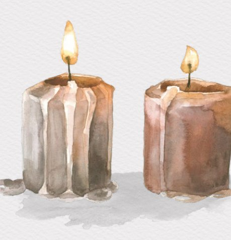

чтобы закончить работу. Если сыщики обвинят их в том, что они тянут время, Хорас язвительно ответит, что отныне проследит, чтобы его люди работали усерднее, а для этого сыщикам лучше идти своей дорогой и не тратить зря время. Язык его тела договаривает: «как бы с вами не случилось несчастья», — хотя вслух эту угрозу он не произнесёт.

При малейшей дерзости со стороны сыщиков рабочие обступят их, явно желая запугать. Это намеренно несоразмерный ответ. Персонажи должны понять, что работяги более чем готовы пустить в ход кулаки и только ждут повода. Сам лорд Дьюар поручил бригаде любой ценой не дать трём сыщикам покинуть округу. Хорас знает, что, будучи формально ниже гостей лэрда, он не может позволить себе втянуться в спор о том, разрешено ли им входить в крепость, пусть и на свой страх и риск. Поэтому он может лишь надеяться отпугнуть сыщиков угрозой немедленной расправы, прежде чем они решатся на такой разговор. Он прекрасно понимает: если он покажется достаточно опасным, они, скорее всего, повернут назад и решат свести счёты через лорда Дьюара, — и его это вполне устраивает. Пусть доктор сам держит этих щёголей в неведении; у Хораса нет ни желания, ни умения этим заниматься.

Он не испугается, если сыщики пригрозят рассказать лэрду о случившемся; напротив, он посоветует им поспешить назад, откуда пришли, и пожаловаться аристократу как можно скорее, не тратя больше ни своего, ни его времени. Он знает, что никакой кары ему бояться не нужно, — и это само по себе тревожная улика, которую сыщики могут заметить, пройдя проверку Психологии. Он несколько неохотнее нанесёт первый удар или поднимет руку на кого-то из персонажей, но если сочтёт это необходимым, будет действовать жёстко и без промедления, хотя остановится — и отзовёт своих людей, — если завяжется драка, которую персонажи, скорее всего, проиграют: ему приказано не причинять им серьёзного вреда. Побеждённым позволят сбежать обратно в особняк, поджав хвосты, а его бригада вернётся к своим занятиям.

Если сыщики не станут разговаривать с ирландцами свысока, а попробуют сойтись с ними по-приятельски или очаровать, их присутствие будут терпеть охотнее, а рабочие станут куда менее враждебны, но всё равно будут их остерегаться и не ослабят бдительности, какими бы дружелюбными и обаятельными ни были персонажи. Ни напоить их, ни отвлечь, ни по-настоящему завоевать их доверие не получится — это быстро станет ясно, если персонажи попробуют. Каждый сыщик всё время будет чувствовать, как ему практически дышит в затылок рабочий с инструментом в руке, откровенно за ним присматривая. Если это им неприятно — что ж, ничего не поделаешь.

Пробраться на стройку украдкой практически невозможно. Лучший способ вырваться из заточения, в которое их поместил доктор, — перелезть через стену по верёвке или лестнице, но даже тогда трудно будет ускользнуть от людей на крыше. Для этого нужно пройти трудные проверки Скрытности, Лазания и Прыжков. Помогло бы и какое-нибудь отвлечение, хотя для этого, вероятно, кому-то из сыщиков придётся пожертвовать собой, чтобы остальные сбежали. Падение может нанести от 1d6 до 3d6 урона (в худшем случае).

Если побег заметят, то, даже если Хорас решит, что его бригада догонит беглецов, первым делом он выкрикнет условное слово, которое лорд Дьюар дал ему как раз на такой случай. Сознание сыщиков это слово не зарегистрирует, но оно запустит психологическую установку, вызывающую химеру (см. «Замыслы доктора», с. 47).

Если кто-то из сыщиков остался по другую сторону стены и находится достаточно близко, чтобы услышать крик Хораса, он, разумеется, тоже станет жертвой нападения химеры.

Вопреки приказу лэрда, некоторые из этих громил на всякий случай припрятали в донжоне несколько охотничьих дробовиков, хотя им строго велено не причинять сыщикам вреда и соизмерять с ними силу. В конце концов, они всего лишь пехота, и им спокойнее, когда есть запасной план. Однако крайне маловероятно,

