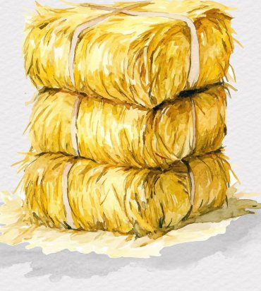

уже дошла до середины лагеря. Хорас выходит вперёд, и Селина цепляется за него, в панике указывая на особняк.

Сыщик не слышит, что она говорит и что отвечает бригадир, хотя тот, похоже, пытается её успокоить. Он гладит её по волосам, как гладят испуганного оленёнка. Один из мужчин берёт одеяло и накидывает ей на плечи, чтобы защитить от холода.

Зато персонаж видит Дава, который размеренно поднимается по той же тропе, по которой пришла девушка.

Она тоже вскоре замечает громадного слугу.

Молодая женщина явно в отчаянии и ищет укрытия за широкими плечами ирландца. Она умоляюще оглядывается налитыми кровью глазами, по её щекам катятся слёзы. Пусть Дав и огромен, но противников у него намного больше. Против стольких врагов он мало что может сделать.

И тогда, хотя этого не слышно, сыщик видит, как рабочие начинают смеяться — сначала тихонько, по-волчьи ухмыляясь, потом в голос, показывая пальцами на бедную женщину, которая озирается в недоверчивом ужасе, не в силах понять, что происходит.

Селину передают дворецкому лэрда, а вокруг неё эхом разносится беззвучный смех рабочих, которые, как она надеялась, её защитят. Когда Дав вытаскивает её из круга света от костра, иллюзия растворяется в небытии, хотя образ охваченного паникой лица молодой женщины ещё долго будет стоять в памяти того, кто видел это воспоминание.

## Амбар

В стороне от фермы Шерманов, на полпути между нею и опалёнными стенами, стоит ветхий амбар, ныне превращённый в склад стройматериалов, который отчасти по-прежнему служит зернохранилищем и сеновалом. Как бы то ни было, внутри навалено более чем достаточно материалов и инструментов, чтобы закончить ремонт стен.

Обветшалые старые доски источены, и сквозь любую из бесчисленных щелей между ними можно заглянуть внутрь. Крыша отчаянно нуждается в починке, а птицы и полевые мыши нашли здесь настоящий рай, куда приходят за пропитанием.

### Находки: следы конюха и пастушек

Амбар — одно из любимых мест сестёр Шерман для их эротических игр. Если их там нет, успешная проверка Внимания может помочь сыщикам найти забытый предмет нижнего белья, наполовину зарытый в солому, или брошенный венок из полевых цветов.

Частое присутствие девушек побуждает и Гаррета, конюха, заглядывать в амбар при каждом удобном случае — под предлогом того, что он набирает тачку сена для лошадей, а на самом деле чтобы подглядывать за своими сладострастными соседками, которые прекрасно знают о его подглядывании и получают от этого извращённое удовольствие. Поэтому успешная проверка Внимания может выявить и следы присутствия соглядатая (например, пустые и разбитые стеклянные бутылки или отпечатки сапог в грязи со следами навоза).

Если кто-то из этих персонажей находится здесь, успешная проверка Внимания (Гаррет подглядывает сквозь щели) или Слуха (пастушки резвятся внутри сарая) может издали привлечь внимание сыщиков и побудить их подойти к постройке.

Зато никаких следов того, что кто-то из рабочих приходит сюда за материалами или инструментами для ремонта, персонажи не найдут.

### Отпечаток: Артур и Глэдис кувыркаются в сене

Внутри сарая — где, к слову, уже нет никаких стройматериалов, только сено и мешки с зерном, — начинают проступать силуэты двух людей. Это Артур и Глэдис, и они флиртуют с застенчивостью ещё не утраченной невинности.

Но страсть двух сердец, бьющихся как одно, вполне способна одолеть и неопытность юности, и навязанные обществом нравы. Сначала они держатся за руки, потом разнимают их и игриво гоняются друг за другом между тюками сена. Затем следуют нежные ласки, щекотка, они катаются, оказываясь то сверху, то снизу, первые (робкие) поцелуи, потом более глубокие и страстные. Наконец их необузданный голод вырывается на волю, и молодых людей уносит желание.

