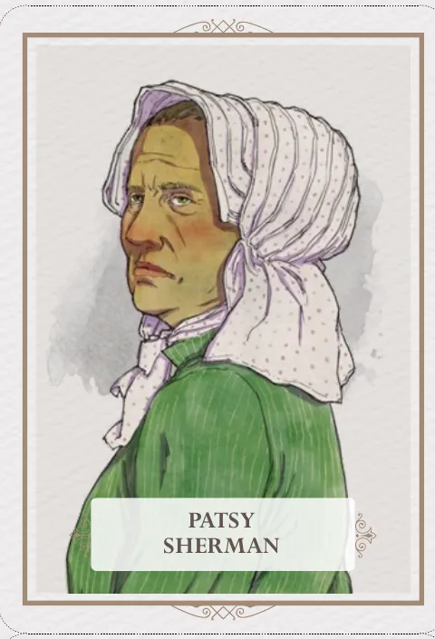

держится фактов — кроме той части, где они воспользовались совершенно беспомощной женщиной, чтобы превратить её в нечто вроде домашней рабыни. Она выкармливает из бутылочки поросят, выгребает навоз из стойл, обирает клещей и делает любую другую работу, для которой не нужно давать ей в руки острый предмет или показывать её другим обитателям поместья.

Ещё одна постройка, где сыщики могут сделать любопытные находки без всяких проверок, если решат войти и осмотреть её, — бревенчатая хижина.

Здесь они найдут сельскохозяйственные орудия, которые в случае нужды сойдут за самодельное оружие. Внутри персонажи услышат загадочный шум, который, если пойти на него, приведёт их в комнату с дюжиной металлических клеток, полных маленьких серых полевых мышей. Животных кормят хорошим зерном и, может быть, даже кусочками сыра. Как нетрудно догадаться, их разводят на корм змеям, тарантулам и скорпионам из террариумов лэрда. Если персонажи спросят, пастухи уклонятся от ответа, заявив, что Дав велел им разводить мышей, вот они и разводят. Время от времени кто-нибудь — обычно дворецкий, а иногда сиделка Реддинг — заходит и забирает несколько мышей, но пастухи вообще стараются не попадаться на пути слугам лорда Дьюара, а уж тем более не останавливаться с ними поболтать.

Наконец, если персонажи обыщут главный хлев и пройдут проверку Внимания со штрафной костью, они найдут завёрнутые в некрашеную шерстяную ткань три полированных бронзовых серпа со странными символами, выгравированными на лезвиях, которые уже начинают зеленеть. Эти инструменты (или оружие) выглядят довольно старыми и, учитывая обычное усердие Шерманов в вопросах чистоты, на удивление ухожены. Все они сохранили более чем приличную остроту.

### Отпечаток-выход: лорд Дьюар гипнотизирует пастухов

На закате облака пылают багрянцем. Далеко внизу возникают четыре фигуры, поднимающиеся по тропе, что ведёт от особняка к ферме пастухов. Впереди быстрым шагом идёт лорд Дьюар. Он не хромает; он даже не опирается на трость, а держит её за древко, словно маршальский жезл. По бокам от него, на несколько шагов позади, идут Дав со своей собакой — слева — и сиделка Реддинг — справа; оба шагают решительно.

Младшая из трёх сестёр Шерман выходит навстречу процессии, преграждая им путь. Сиделка Реддинг деловито выступает вперёд, хватает девочку за руку, отводит в сторону, чтобы дать дорогу доктору, а потом тащит её за собой, пока процессия идёт дальше.

Из дома выходят Хэнк и Пэтси. Хотя они явно насторожены, они знают, что не могут всерьёз противиться лэрду. Старшая сестра, вышедшая вслед за родителями, в испуге бросается бежать, но дог Дава настигает её, прежде чем она успевает убежать далеко, и останавливает её. Слуга подходит сзади, хватает девушку за шиворот и тащит назад, бросая её к ногам родителей, перед которыми теперь стоит лэрд. Девушка не смеет поднять глаз от земли.

Затем Дав заходит в дом и вскоре возвращается с третьей сестрой, перекинутой через плечо, как мешок картошки; она бесполезно брыкается. Дворецкий деловито ставит девушку рядом с остальными членами семьи и вновь занимает своё место позади лорда Дьюара.

Лэрд лезет в карман жилета и достаёт переливающийся опал на цепочке. Он начинает раскачивать его взад и вперёд перед изумлёнными взглядами Шерманов. С каждым взмахом опал светится всё ярче, а фигуры, собравшиеся у фермы, становятся всё серее и начинают блёкнуть. Вскоре персонаж видит только свет опала, который с каждым взмахом делится на множество самоцветов, одинаково сияющих. Постепенно персонаж начинает слышать гипнотический голос доктора — чего в мире за завесой происходить не должно.

