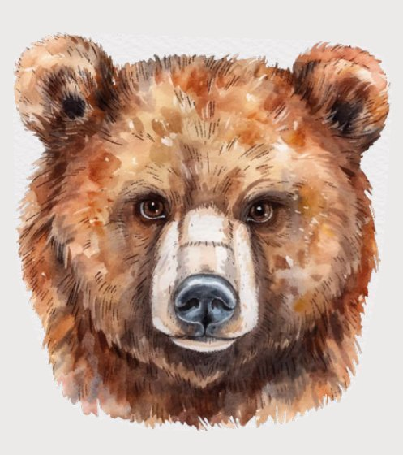

Только они уже не в мире за завесой. Разные огни, которые видит сыщик, — это отражения, которые отбрасывают зеркала машины лэрда, а голос доктора — это просто голос Амадеуса Дьюара, который всё настойчивее призывает их проснуться.

Путешествие по царству Аида окончено… по крайней мере, пока.

## Охотничьи угодья

Вряд ли сыщики доберутся до охотничьих угодий перед поместьем лорда Дьюара. Если же доберутся, то, вероятно, с лэрдом и его приспешниками на пятках, в тщетной попытке сбежать. Аристократ — опытный охотник и хорошо знает округу, а даже если беглецы доберутся до деревни, вряд ли они найдут там кого-то, кто охотно им поможет.

Дорога через угодья плохая: узкая и на некоторых участках опасная — там она безрассудно близко огибает крутые склоны и канавы, которые, хотя и не слишком рискованны для пешехода, могут стать причиной смертельного несчастья, если мчаться галопом верхом или ехать на одном из этих новомодных самоходных экипажей. Лес по обе стороны тропы густой, полный охотничьих ловушек, хищников и браконьеров. Кроме того, ранним утром и ночью местность часто окутывает низкий густой туман, из-за которого видно куда хуже, даже если держаться тропы.

Лес уже не сухой, мёртвый и бурый, каким он был, когда сыщики впервые приехали, а густой и зелёный.

### Находки: ловушки, охотники и звери

В зависимости от обстоятельств (бежать по дороге — не то же самое, что пытаться пробраться через подлесок, чтобы тебя не поймали) персонажи смогут пройти проверки Внимания, Выживания, Чтения следов, Естествознания, Слуха или Скрытности разной сложности, чтобы вовремя заметить опасности, подстерегающие их в лесу, или не дать опасностям заметить себя. Как бы то ни было, — сейчас вы в этом убедитесь, — внешность обманчива, и угодья, возможно, не так опасны, как кажутся.

Первая угроза — охотничьи ловушки: и те, что поставил сам лэрд, и те, что поставили (или даже соорудили на скорую руку) браконьеры. Ловушки лорда Дьюара рассчитаны больше на людей, чем на животных, и обычно не предназначены убивать: как правило, это сети или силки, но также и глубокие ямы, которые шайка браконьеров не успела бы выкопать, не рискуя попасться. Некоторые силки браконьеров, напротив, любой человек без труда заметит и распознает, или в них будет приманка, которая, может, и не насторожит дикого зверя, но ясно подскажет сыщикам, что они приближаются к ловушке. Другие, конечно, будут спрятаны лучше. Разные ловушки могут наносить от 0 до 1d6 урона, а также более или менее надёжно обездвиживать добычу. Однако если сыщики действуют сообща и могут помогать друг другу, найдётся мало препятствий, которых они не смогут преодолеть с помощью верёвки, ножа или некоторого времени и смекалки.

Вторая опасность — дикие звери. Правда в том, что, кроме медведей, ни одно другое животное и не подумает напасть на человека. Сейчас весна, и пищи вдоволь, так что, если только персонажи невзначай не будут угрожать детёнышам какого-нибудь хищника, большинство диких созданий, включая самых грозных, просто убегут. Можете пугать персонажей следами или помётом, но в конечном счёте единственные опасные четвероногие, о которых им стоит беспокоиться, — это гончие.

Большинство браконьеров тоже будут бояться сыщиков больше, чем сыщики — их. Это простые люди, а не хладнокровные убийцы, какими их хотели бы представить сыщикам обитатели замка Дьюар, и они, вероятно, скорее рискнут штрафом за пару браконьерски добытых кроликов, чем станут отвечать за то, что перестреляли кучку аристократов, бестолково бродящих по лесу. Даже если сыщики поймают их с поличным, они сначала попытаются запугать персонажей или договориться с ними, хотя в итоге могут прибегнуть к силе, если это нужно, чтобы сбежать или защититься. Но даже тогда они постараются никого серьёзно не ранить, не говоря уж об убийстве. Если сыщики хорошо используют навыки общения, браконьеры могут даже помочь персонажам (хотя, разумеется, не дойдут до того, чтобы открыто выступить против лэрда).
