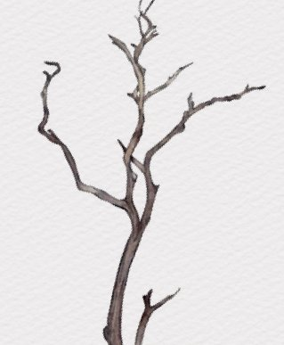

### Отпечаток: тело Глэдис найдено

Видение обретает форму как раз тогда, когда солнце начинает выглядывать из-за верхушек деревьев. Вдали ещё видна закопчённая римская стена, окаймляющая поместье лэрда; её освещают солнечные лучи, которые медленно подбираются к лошади, мирно пасущейся у обочины. На животном нет ни узды, ни седла, хотя дикой лошадь не кажется.

Неподалёку проступает ещё одна фигура: это безжизненное тело Глэдис Косгроув, раскинувшееся в неестественной и очень неприглядной позе на камне, запятнанном засохшей кровью.

Несмотря на стелющийся туман, в грязи и гравии дороги видны неровные следы лошади, которые резко обрываются прямо перед упавшим стволом, перегородившим тропу, — животное, видимо, не решилось через него прыгнуть. Судя по расстоянию между следами, лошадь явно неслась во весь опор; учитывая время суток, несчастье, должно быть, случилось ночью. Других улик поблизости нет: всё говорит о том, что Глэдис неудачно упала с лошади.

В этот момент на тропе появляются Артур и Джаспер верхом на своих лошадях. Заметив вдали эту картину, Артур пришпоривает коня и в мгновение ока оказывается рядом с невестой: трясёт её и обнимает, а сам рушится в море мучительных стонов. Джаспер подъезжает всего несколько секунд спустя и спешивается, чтобы попытаться утешить Артура, но тот грубо отталкивает его, с лицом, искажённым болью.

Начинает накрапывать очень мелкий дождь, быстро промачивая обоих мужчин и тело Глэдис, затем постепенно растворяя все три фигуры, пока наконец не смывает всю сцену. Разумеется, никто из сыщиков не вспомнит, что пережил подобное. Если сможете, заставьте их подумать, что это может быть предзнаменованием того, что их ждёт.

