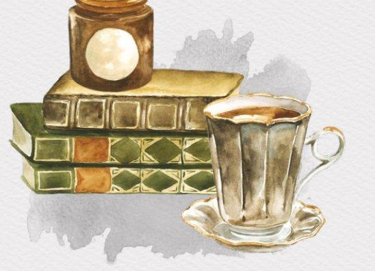

посвящённые исследованиям истерии и гипноза, а также трактаты о явлении синестезии, когда стороны реальности воспринимаются не тем чувством, что обычно (обоняние звуков, видение вкусов и т. д.).

### Хирургия мозга

Лечение случаев эпилепсии, не поддающихся доступным лекарствам, открыло дорогу к изучению хирургии мозга — главным образом на уровне височной доли, хотя в некоторых текстах обсуждаются и изменения личности, вызванные повреждениями лобной области мозга. Такие пациенты, по-видимому, утрачивают нравственное чувство и действуют, не считаясь ни с какими ограничениями или общественными привычками.

Самые видные исследования на эту тему принадлежат физиологу Карлу Вернике, который в своём труде «Афазический симптомокомплекс», изданном в 1874 году, разграничивает по причине возникновения сенсорную афазию (вызванную повреждением височной доли) и моторную афазию (вызванную повреждением лобной доли мозга).

### Расстройства сна

Доктор, похоже, особенно живо интересуется расстройствами сна. Здесь множество текстов о явлениях осознанных сновидений, ночных страхов, кошмаров, лунатизма и телесной диссоциации, которая включает и ощущение, будто ты заперт в собственном теле, и выход из тела, когда кажется, что ты его покинул. Согласно этим статьям, это две стороны одной медали: чувство отчуждённости от собственного организма.

Некоторые из этих томов, менее строгие с научной точки зрения, рассуждают о причинах потребности во сне и о вредных последствиях его недостатка и даже утверждают, что есть задокументированные случаи, когда люди с особыми дарованиями в дальних краях, например в Индии, с помощью медитации сумели вовсе избавиться от потребности во сне.

### Ветеринарная зоология

В библиотеке есть несколько томов по зоологии и ветеринарный трактат. В одном из этих атласов анатомии животных есть поразительная анатомическая модель несуществующего существа. Это смесь других изучаемых животных, в которую вносят нужные изменения, чтобы получить требуемый анатомический образец. Изучив эту модель, можно таким образом получить понятийную основу для понимания анатомии большинства животных, которую затем можно превратить, скажем, в голубя, добавив фабрициеву сумку и заменив передние конечности крыльями, или в жвачное животное, добавив второй желудок, или в осьминога, добавив ещё два сердца, и т. д.

### Водолечение

Для человека, который держит санаторий, у доктора в библиотеке мало книг о целебных свойствах термальных вод. Беглый просмотр этих трудов наводит на мысль, что польза для здоровья объясняется растворёнными в воде минералами — вода может быть богата серой, железом, кальцием, магнием и т. д.

Некоторые главы более современных томов собрания исследуют и то, не могут ли микроорганизмы в жидкости отвечать за другие благотворные — или, в некоторых случаях, вредные — действия этих вод.

### Электричество и магнетизм

Самые современные труды в собрании лэрда посвящены недавно открытым областям электричества и магнетизма. Хотя эти научные дисциплины ещё в младенчестве, по мнению авторов этих томов, они могут оказаться ключом к объяснению физических явлений, само существование которых до сих пор ставилось под сомнение. Многие из этих трактатов, особенно те, которым лэрд, похоже, уделял больше всего внимания, — технические руководства, и их страницы испещрены схемами и математическими расчётами самого доктора Дьюара. Однако законы физики и математические понятия, лежащие в основе этих пометок, слишком сложны, чтобы сыщики могли толком их истолковать.

### Ботанические трактаты

Здесь скромное, но разнообразное собрание книг по ботанике и руководств по садоводству и плодоводству. Доктор, похоже, проявлял особый интерес к приёмам прививки, которые делают возможным то самое чудо, о котором говорит испанская пословица, — попросить вяз уродить груши.

