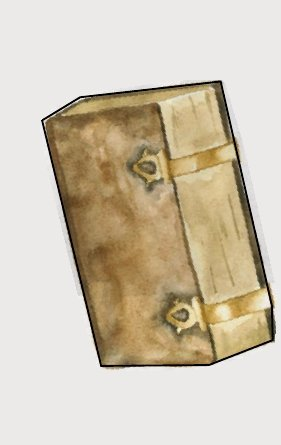

Есть также тексты об экзотических и ядовитых растениях, несомненно пригодившиеся доктору во время его экспедиций в джунгли. Особого внимания из-за необычности предмета заслуживает глава о плотоядных растениях, хотя на самом деле они угрожают лишь мелким насекомым. Вместо челюстей у них маленькие липкие ловушки, так что выглядят они куда менее эффектно, чем можно было бы ожидать.

### Учение о животном магнетизме

Доктор Дьюар собрал довольно обширную коллекцию трудов о теориях Франца Антона Месмера и его методах лечения, в которых тот использовал электричество, металлы, дерево и, разумеется, гипнотические пассы. Бо́льшая часть из них обсуждает теории животного магнетизма, более мощного, чем тот, что дают металлические магниты, и его применение рассматривается в основном в лечебных целях.

Доктор подчеркнул место, где сказано: «Существует всеобщий флюид, который облегчает связи и влияния между живыми существами, неодушевлёнными и небесными телами. Этот флюид можно передавать с помощью определённых магнетических пассов».

Стоит отметить и явно зачитанный экземпляр книги Иоганна Генриха Юнга «Теория пневматологии», в которой автор отождествляет магнетический флюид с эфиром.

### Трактаты по френологии

Лэрд собрал скромную подборку сочинений об этой спорной научной дисциплине, которая берётся определять черты характера и склонности человека, измеряя шишки на его черепе. Особого внимания заслуживает книга Джорджа Комба «Система френологии» 1830 года, в которой основатель Эдинбургского френологического общества разбирает положения Франца Йозефа Галля. Выделяются главы о нимфомании, которые связывают это состояние с чрезмерно длинной и горячей шеей.

### Трактаты о тропических болезнях

Лорд Дьюар хранит со времён своих путешествий многочисленные тома о тропических болезнях и о том, как их лечить. Книги в основном посвящены малярии, при которой больному следует давать хинин, добываемый из коры хинного дерева, и жёлтой лихорадке, которую лечат слабительными из растения ипекакуана и рвотным камнем. В томах есть и рекомендации по обеззараживанию судов, приходящих из земель, где эти болезни распространены, а также состав благовоний, которыми следует окуривать грузы, людей и корпуса кораблей.

Особого внимания заслуживают сочинения Карлоса Финлея, который смело предполагает, что жёлтую лихорадку может вызывать укус комара, и Роберта Коха, который называет причиной холеры бациллу.

Внимание персонажей могут привлечь и некоторые пометки, сделанные рукой самого лэрда, о смерти ботаника Ричарда Спруса, который в 1850 году предпринял несколько экспедиций в поисках хинного дерева; в этих заметках доктор Дьюар приписывает его кончину таинственному «проклятию сокровища Льянганатес», хотя больше ничего здесь не поясняет.

## Антропология и гуманитарные науки

Этот раздел библиотеки лучше всего назвать разношёрстным. Он состоит из избранной и хорошо подобранной выборки трудов на самые разные темы антропологии и человеческой культуры. Он охватывает также такие предметы, как география, история, религия и даже политика.

### Экспедиции и доколумбовы сокровища в бассейне Амазонки

На этих полках множество сведений о реке Амазонке, о культурах, процветавших на её берегах до испанского завоевания, и об их художественном наследии. Здесь есть всевозможные географические атласы и сборники карт этого края, а также сведения о разных экспедициях, отважившихся проникнуть на эту территорию.

Здесь описано множество разных племён и делается вывод, что в амазонских джунглях не было объединяющей империи, которая привела бы к принятию общего языка, — этим и объясняется разнородность этих народов.

Хотя инки оказывали влияние на народы Амазонии (они покорили чачапойя и дали им это имя) и есть свидетельства торговли между племенами джунглей и горцами, инки, по-видимому, заселяли самое большее крошечный участок у истоков притоков Амазонки. Это должно насторожить сыщиков: они явно путаются в том, откуда происходит сокровище, которое они ищут, — и показать, насколько они несведущи в доколумбовой истории.

Хотя тексты охватывают и культуры равнин Мохос (здесь есть экземпляр «Краткого описания поселений Общества Иисуса в провинции Перу, именуемой Мохос» иезуита Франсиско Хавьера Эдера, датированного 1772 годом и описывающего постройки
