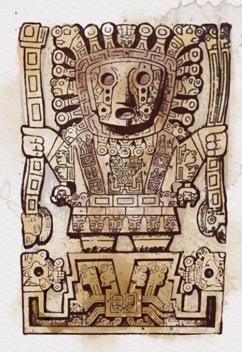

в этих селениях), основная часть трудов посвящена народам тупи, андаки (живущим в бассейне реки Какета и названным так по галлюциногенному снадобью, которое готовят их шаманы) и культуре Мараджоара в дельте Амазонки, известной своей расписной и резной керамикой и монументальными курганами (назначение которых спорно, но они могли служить могильниками, жилищами, укреплениями и т. д.).

Книги этого собрания охватывают всё — от экспедиций Орельяны 1542 года на поиски Ла-Канелы, или Долины Корицы, и Эльдорадо (и его встречи с народом, состоящим из одних женщин, которым остальные племена платили дань, — по рассказу доминиканца Гаспара де Карвахаля) или аделантадо Педро де Урсуа (убитого во время мятежа товарищами по экспедиции в 1561 году) до более современных вылазок натуралистов Генри Уолтера Бейтса и Альфреда Рассела Уоллеса в 1848 году, которые даже называли джунгли «великим зелёным адом». Есть даже рассказы об экспедиции Александра Гумбольдта и Эме Бонплана 1800 года по каналу Касикьяре, соединяющему бассейны Амазонки и Ориноко.

Более тесная связь с инками объясняется тем, что первые испанские отряды снаряжались на землях народа кечуа и отправлялись оттуда, а не из дельты реки, хотя Орельяна и попытался повторить своё первое плавание в обратном направлении и погиб при этом.

Если у персонажей её ещё нет, дайте им раздатку о сокровище Льянганатес (раздатка 9), когда они будут смотреть эти книги.

### Империя инков

Хотя собрание доктора Дьюара охватывает многие доколумбовы культуры, в том числе ацтеков, майя и ольмеков, персонажи, скорее всего, предпочтут посмотреть тексты об империи инков.

Учитывая необъятность предмета, этот раздел даёт лишь краткий обзор. К счастью, Хранителю не составит труда найти дополнительные сведения о любых сторонах, которые здесь опущены.

Цивилизация кечуа зародилась в высокогорьях Анд. Это была самая многолюдная и развитая цивилизация доколумбовой Америки. В отличие от майя (лучше разбиравшихся в математике, письме и хозяйстве) или ацтеков (выдающихся зодчих и строителей), инки выделялись превосходством в военном деле. Высшим божеством был Инти (бог солнца), а своего царя, Сапа Инку, народ считал сыном Солнца, господином и владыкой всего.

Империей управляли с помощью десятичной иерархической системы — от чунки (группы из десяти семей) до хуну (группы из десяти тысяч семей). Преемником Инки выбирали самого способного наследника (это правило порождало немало конфликтов, но и позволяло прийти к власти более способным правителям).

Хозяйство инков обходилось без рынков и денег. Подати платили трудом, а обменом пользовались как средством торговли. Историю записывали в песнях и в знаменитых кипу (узелковых шнурах из шерсти или хлопка), искусство чтения которых со временем утрачено. Эта культура не заботилась об исторической точности, и правители могли по своему усмотрению вычёркивать прошлые события, как в той или иной мере всегда бывало во всех цивилизациях.

Архитектуру кечуа отличают простота, симметрия и прочность. В её золотой век двери и окна делали трапециевидными, а стены дворцов окаймляли золотом. Иногда соломенные крыши покрывали или украшали цветными перьями, хотя важное искусство инков — работа с перьями — чаще служило для изготовления одеял, рубах и зонтов. Дайте персонажам раздатку о сокровище Льянганатес (раздатка 9), если они обратятся к этому собранию и ещё не получили её при другом поиске в библиотеке.
