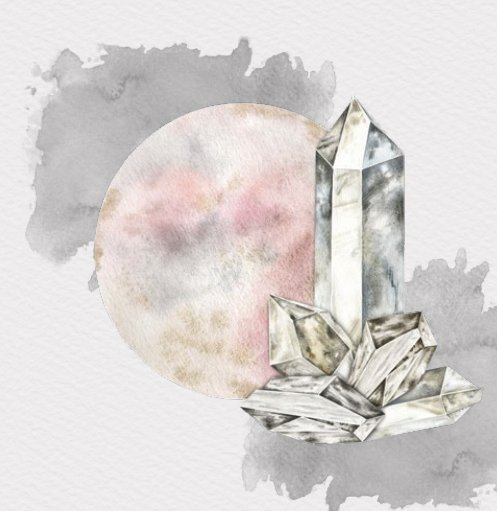

чаинках), пиромантию, геомантию или онейромантию (толкование снов), — тексты лэрда рассматривают и менее известные способы: акутомантию, которая состоит в истолковании узоров, образуемых иглами, брошенными на поверхность или в воду; ихтиомантию, основанную на осмотре рыбьих внутренностей; гиромантию, при которой нужно быстро кружиться внутри круга из букв и пытаться уловить послание; клеромантию греческого происхождения, где используют кости или бобы; ойномантию, где используют вино; клидономантию, которая стремится извлечь предзнаменования из пророческих слов, случайно услышанных; молибдомантию, проливающую свет на будущее по формам, которые принимает расплавленный металл, например свинец или олово, когда его выливают в воду; или оракул зулусов, при котором советуются с предками, бросая сочетание звериных костей, семян и камней на матерчатое покрывало, представляющее разные области или людей из жизни вопрошающего.

Тексты библиотеки исследуют и возможное происхождение таких предчувствий, которое по-разному приписывают божествам, духам, собственным дарованиям гадателя или природной причине, пока не объяснённой наукой.

### Боги, духи и их изображение в доколумбовых культурах

Хотя в библиотеке лэрда есть и много трудов о духовных верованиях майя и ацтеков, сыщиков почти наверняка больше всего заинтересует раздел о цивилизации кечуа.

Имеющиеся сведения слишком обширны, чтобы приводить их здесь. Достаточно сказать, что в делах веры правители инков насаждали поклонение Инти (богу солнца) поверх божеств других покорённых народов, таких как Пачамама.

Их картина мира включала существование трёх миров: Ханан Пача, или небесного царства, обители богов и праведников, которое олицетворял кондор; Кай Пача, или земного царства, которое олицетворяла пума; и Уку Пача, внутреннего, или подземного, мира, царства мёртвых, куда можно было попасть через пещеры и которое олицетворял змей.

Их главными божествами были Виракоча, Инти, Мама Килья, Пачакамак, Мама Коча и др. Дополните сведения, которые вы даёте игрокам, материалом из раздела «Сокровище инков» главы «Замыслы доктора».

Были, однако, и другие, младшие боги и богини, такие как Ильяпа (бог грома и битвы), Чуйчу (радуга, бог красоты, предназначенной для знати), Кука Манка (богиня волшебных трав), Сара Манка (богиня пищи), Чинчай (богиня кошачьих), Уркавай (змей — страж подземного мира), Супай (бог смерти и владыка подземного мира), Кон (бог засух), Мальку (бог закона) и др.

Если сыщики обратятся к этому собранию, а вы ещё этого не сделали, дайте им раздатку о сокровище Льянганатес (раздатка 9).

### Перевоплощение и одержимость

Несколько трактатов библиотеки исследуют возможность того, что духи или души умерших снова вселяются в живое тело — либо путём перевоплощения, либо путём одержимости, временной и добровольной, как у медиумов, которые служат охотными проводниками таким призракам, или злонамеренной и нежеланной.

В текстах приводятся примеры верящих в перевоплощение культур и религий со всего света — от Бирмы и Таиланда до тибетских лам, африканских и австралийских племён или авраамических общин, таких как друзы в Сирии. Эти перевоплощения не обязательно ограничиваются человеческими телами, поскольку духи могут приспосабливаться к другим вместилищам, например к животным или даже растениям. Некоторые теории утверждают, что у всех душ одно происхождение в далёком прошлом, другие же полагают, что одни души древнее других, но почти все сходятся в том, что перевоплощение влечёт за собой процесс духовного созревания и научения и что к знаниям, обретённым в прошлых жизнях, иногда можно получить доступ с помощью гипнотической регрессии.

Упоминания об одержимости восходят к пифиям, или дельфийским оракулам, а духов иногда можно призвать с помощью таких способов, как автоматическое письмо, заиря или сеансы с доской Уиджа.
