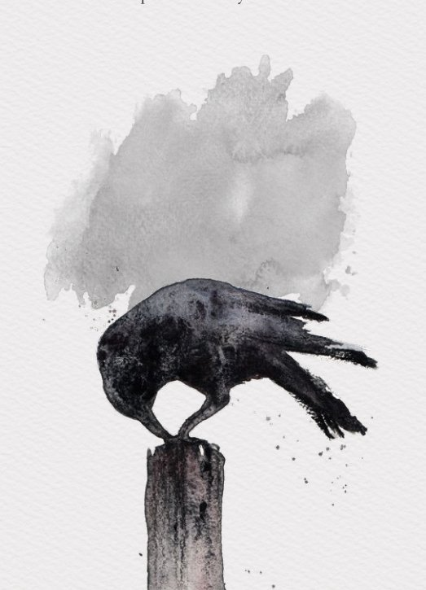

общем для всего человечества. Есть также трактаты о телепатии и месмеризме — своего рода первобытном животном магнетизме, позволяющем сильным умам властвовать над слабыми.

Перекрёстные ссылки в этих книгах указывают на труды о перевоплощении душ и о доступе к воспоминаниям прошлых жизней — обычно через гипноз, но также через сны или обрядовые переживания. Наконец, некоторые руководства этого собрания дают практический обзор различных техник медитации, позволяющих высвободить скрытые способности разума.

Если сыщики обратятся к этому разделу, дайте им раздатку о книге об оккультизме (раздатка 10), если вы ещё этого не сделали.

### Теософия

Особого внимания заслуживает обширное собрание трудов Альфреда Синнетта и Елены Блаватской, основательницы Теософского общества, а также несколько номеров журналов «Теософ» и «Люцифер». Забытую между страниц этого собрания, сыщики найдут фотографию лорда Дьюара — лет на двадцать пять моложе — со знаменитой дамой и несколькими другими людьми, снятую в Каире в 1871 году, если верить надписи на обороте, где значится также «Спиритическое общество».

Лорд Дьюар выделил мысль о том, что дух нисходит в материю, а материя восходит, чтобы стать духом, в круговом действии, о котором говорится в некоторых трудах. Он отметил также места, где объясняется, что знания мадам Блаватской исходят от «великих душ» (махатм), которые будто бы обрели власть над процессом смерти и перевоплощения.

### Големы, каббала и создание искусственной жизни

Эти тексты посвящены еврейской, герметической и христианской гебраистской каббалистической традиции. Особенно любопытны документы, связывающие сфирот Древа Жизни со строением человеческого тела. Особое внимание уделено десятой сфире, Малхут, которая соответствует желанию получать, физической материи, сосуду, эго и уничтожению самости.

Судя по пометкам на полях, лорда Дьюара, похоже, в некоторой мере завораживает процесс наделения жизнью мёртвого существа, а затем удержания этой жизни в созданном теле с помощью слов силы. Он также задаётся вопросом, откуда взялся бы «дух», дающий голему животворящее дыхание, если у голема нет души, и не связано ли отсутствие души с механическим поведением голема, не движимого никакой собственной волей.
