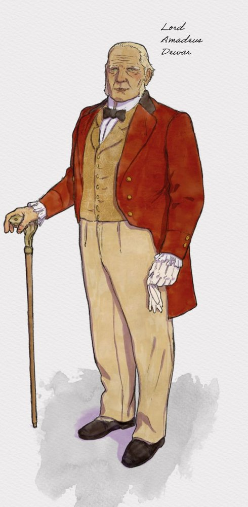

## Необъяснимые события

Эти возможности — то, что питает приключение. Это паранормальные (или по крайней мере таинственные) происшествия, призванные усилить напряжение и создать атмосферу ужаса, которой требует история. Разумеется, вы можете использовать их и как инструменты для множества других целей.

### Странные звуки

Это, безусловно, самый простой и быстрый способ сдвинуть с места ситуацию или закончить застрявшую сцену. Часто даже не нужно предлагать убедительного объяснения того, что происходит на самом деле. Вот несколько примеров:

- **Шёпот старухи.** Одному из сыщиков покажется, что он слышит голос престарелой леди Эдны, которая с кем-то шёпотом разговаривает. Это может случиться поблизости от её покоев, но может произойти и где-нибудь далеко от них — например, в часовне, мавзолее или музыкальном салоне. Как бы они ни старались, им не удастся разобрать слов или понять, говорит ли старуха сама с собой, молится или разговаривает с кем-то ещё. Если они войдут в спальню леди Эдны, то найдут её мирно лежащей в постели, как и следовало ожидать. Лучше всего запускать это событие глубокой ночью, но оно может хорошо сработать и тогда, когда они исследуют особенно жуткое место или такое, где слышны звуки, дающие волю воображению, например подземные пещеры, кишащие летучими мышами.

    Голоса, как вы уже догадались, звучат в голове у персонажа. Это следствие жутких методов лечения доктора Дьюара, лишения сна, стресса, которому подвергли сыщиков, и т. д. Стоит персонажу упомянуть о них спутникам (которые ничего не услышат), как семена упадут и в их души, и в следующий раз голоса будут слышать уже они.

    Поскольку это галлюцинация, связанная с безумием персонажа, дополнительной потери Рассудка она не влечёт.

- **Фортепиано.** На этот раз игру на фортепиано слышат все трое сыщиков. К сожалению, они будут довольно далеко от музыкального салона, и к тому времени, как они туда доберутся, мелодия смолкнет. С этого момента их разум может играть с ними шутки, как в случае с шёпотом, заставляя их слышать инструмент, даже когда на нём никто не играет. Эта сцена может произойти днём, но гораздо тревожнее будет, если она случится ночью.

    Хотя за этим необычным происшествием, скорее всего, стоял Виктор Бердетт, он не единственный вариант.
