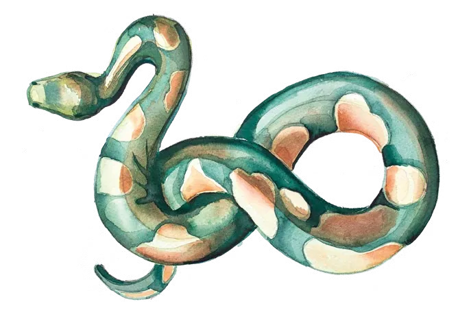

Бывал ли он когда-нибудь в борделе? Вероятно. Последние несколько лет в университете были довольно бурными, но воспоминания о них расплывчаты. Признается ли он другу, откуда взялся подарок, который так много для того значит? Как отреагирует Джаспер, если Артур поделится с ним своими соображениями о непристойном происхождении этой важной памятной вещицы из его прошлого? Что будет, если монеты коснётся Глэдис?

### Глэдис Косгроув: вырванные страницы

Эта сцена — личный вариант случайной находки «Кто-то рылся в вещах персонажей»:

Глэдис замечает, что в её дневнике не хватает страниц. Как ни странно, на связности записей это, похоже, не сказывается. Учитывая, насколько сумбурны её записи, вполне возможно, что на пропавших страницах она написала стихотворение или, может быть, театральную сценку, которые кто-то потом вырвал. Она могла даже сделать это сама, недовольная своими литературными опытами или стесняясь их, и даже не помнить об этом.

Лучше всего показать эту сцену, когда сыщица скажет вам, что записывает в дневник что-то очень важное, чтобы не забыть, потому что начинает сомневаться в собственном рассудке. Если вы тогда скажете ей, что есть признаки того, что из тетради уже вырвали несколько страниц, она самым леденящим образом поймёт тщетность своих попыток, и её охватит сокрушительное чувство беззащитности. Не будем забывать: дневник — одна из опор её предыстории.

### Артур Уилтшир: змеиный яд

Эта сцена связана с деперсонализирующей галлюцинацией, в центре которой — Артур.

В какой-то момент дядя или сиделка Реддинг оказывают племяннику лорда Дьюара обычную медицинскую помощь. После этого ему необъяснимым образом начинает казаться, что рука не его, что она его не слушается. Он чувствует, как своего рода гангрена или яд расползается от того места, куда доктор Дьюар наложил свои мази, и что его рука превращается во что-то чуждое ему, — и что всё его существо, до последней частицы, тоже неизбежно претерпит превращение по мере того, как распространяется заражение. Только тогда он понимает, что получил рану не на дуэли, — его укусила змея. В этом нет никакого смысла, но Артур почему-то в этом уверен.

Ещё один удачный момент для этой сцены — когда сыщики начинают расспрашивать о дуэли и даже осматривают рану. Хотя остальным персонажам нужно сказать, что рана похожа на порез от шпаги, Артур должен упорно настаивать, что на самом деле его укусила змея. После этого у него должно начаться то самое чувство превращения, что описано в предыдущем абзаце.

Эта сцена чрезвычайно полезна, чтобы придать смысл финальному противостоянию с лэрдом. Если дуэли не будет, не останется никаких незавязанных концов: игроки забудут этот эпизод. Но если она состоится и вы вернётесь к этому предзнаменованию, когда лорд Дьюар пронзит руку Артура, всё вдруг встанет на свои места, и вы добьётесь за столом потрясающего эффекта.
