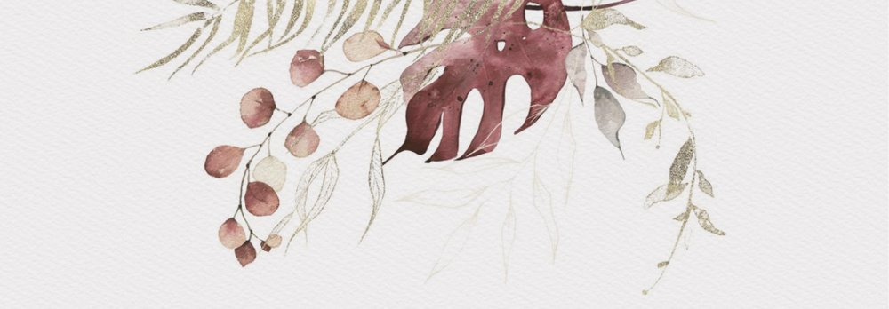

## Лорд Амадеус Дьюар

*69 лет. Врач, охотник, исследователь и таксидермист. Высший класс (богатый).*

Как и многие другие аристократы своего времени, лорд Дьюар — образованный учёный и исследователь с разносторонними интересами, простирающимися от всех областей естественных наук до мистики и паранормальных явлений, не минуя антропологию и древнюю историю. Это человек широких взглядов, но упрямый, с железной волей. Его отец, лорд Оуэн, с самого раннего детства старался вытравить из него всякую мягкость, и юный Амадеус стыдился облегчения, которое втайне испытал, когда отец случайно погиб в ссоре с Колумбусом Тведдлом. Тведдл затем занял место покойного лорда и прижил с матерью Амадеуса, леди Эдной, дочь Фиделию, хотя пара так и не поженилась.

Движимый подсознательным желанием покинуть замок Дьюар, Амадеус путешествовал по свету, финансируя всевозможные экспедиции и исследуя все уголки земного шара. Он взял маленького Элдона Дава в воспитанники и слуги, найдя мальчика в глухом краю Нигерии. Примерно в то же время он подружился с сэром Эдмундом Брамли. Не в силах спокойно смотреть, как сэр Брамли совершает со своим сыном Джаспером те же ошибки, что лорд Оуэн совершил с ним самим, он убедил друга позволить ему взять под крыло и мальчика. Вскоре между Амадеусом и Джаспером возникла привязанность, выходившая за рамки простой дружбы. Однако ей положил конец приезд Артура Уилтшира, сына Фиделии, в которого Джаспер безумно влюбился. Сломленный последовавшими смертями Фиделии, Глэдис, Артура и Джаспера, лорд Дьюар пытался покончить с собой. Пережив в результате клиническую смерть, он пустился исследовать сам подземный мир, пытаясь вырвать своих любимых из когтей Мрачного Жнеца.

**Имущество:** трость с рукоятью в виде змеиной головы (1d6+БкУ), в которой спрятана рапира (1d6+1+БкУ+яд), снабжённая механизмом, который, когда оружие обнажают, покрывает клинок сильным, сверхбыстродействующим наркотическим веществом; ключи от главного входа в особняк, от входа через столовую для гостей, от шкафов лазарета, от его кабинета и ящиков письменного стола в нём, от его покоев, от лаборатории и шкафов и ящиков, где хранятся опасные вещества, от клиники машины Харона и от трёх висячих замков Галереи химер; подвеска с опалом, которой он гипнотизирует своих жертв; и копия маленькой музыкальной шкатулки Фиделии.

**Внешность и поведение:** обаятельный старик, склонный к преувеличениям, он искусно пользуется своим красноречием, чтобы располагать к себе людей. Хотя он хромает и ходит с тростью, рукоять которой — чучело змеиной головы, на самом деле он куда проворнее, чем кажется, и, если ему нужно быстро двигаться, повинуясь инстинкту или в чрезвычайной ситуации, порой вовсе забывает беречь ногу. Для отыгрыша представьте Альбуса Дамблдора из «Гарри Поттера» в последние годы его жизни.

```stat
СИЛ 50   ВЫН 40   ТЕЛ 60   ЛВК 70   ИНТ 90
НАР 60   МОЩ 98   ОБР 98   Рассудок 00   ПЗ 10

Бонус к урону: нет.
Комплекция: 0
Скорость: 5
Стрельба (пистолет) 70% (35/14), урон 1d6+1 (выстрелов за раунд: 1/4; патронов: 1; осечка: 95).
Стрельба (винтовка/дробовик) 90% (45/18), урон 4d6+2/2d6+1/1d4 (выстрелов за раунд: 1 или 2; патронов: 2; осечка: 100).
Ближний бой (меч) 90% (45/18), урон 1d6+1+БкУ+яд.
Ближний бой (драка) 60% (30/12), урон 1d3+БкУ.
Уклонение 90% (45/18).
```
