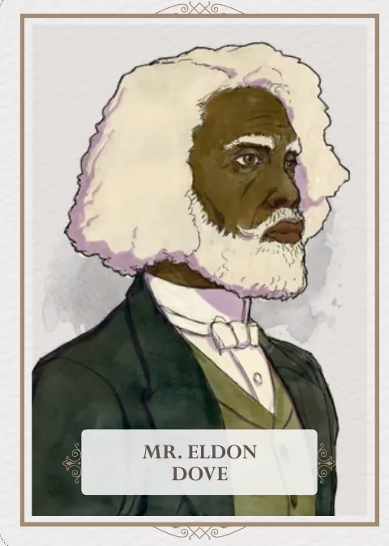

## Мистер Элдон Дав

*47 лет. Чернокожий дворецкий и телохранитель. Рабочий класс (бедный).*

Мистер Дав родом из Нигерии. Лорд Дьюар встретил его совсем маленьким и решил подарить ему лучшее будущее в цивилизованном Соединённом Королевстве. Лэрд научил его всему, что он знает, и его преданность доктору абсолютна.

**Имущество:** на шее он носит большой ключ (от сейфа в своём кабинете), а его пёс Орфей (дог, с которым он, кажется, общается телепатически) всегда появляется, когда нужен. У него также есть ключи от всех четырёх входов в замок Дьюар, от своего кабинета и ящиков в нём, от фортепиано, от бара в гостиной, от своей комнаты, от погреба лэрда и стеллажа с бутылками, от лесных ворот, от кабинета и покоев лорда Дьюара и от комнат сыщиков. В одном из карманов он держит одну из копий музыкальной шкатулки, которыми не дают сыщикам выйти из комнаты.

**Внешность и поведение:** воплощение британской невозмутимости, он говорит низким, хрипловатым голосом, чинно сцепив руки за спиной. Для отыгрыша представьте лейтенант-коммандера Бортуса из сериала «Орвилл».



```stat
СИЛ 90   ВЫН 90   ТЕЛ 90   ЛВК 85   ИНТ 70
НАР 45   МОЩ 75   ОБР 40   Рассудок 00   ПЗ 18

Бонус к урону: +1d6
Комплекция: 2
Скорость: 7
Ближний бой (драка) 86% (43/17), урон 1d3+БкУ.
Уклонение 90% (45/18).
Навыки: Бухгалтерское дело 55%, Обращение с животными 80%, Антропология 20%, Оценка 51%, Археология 20%, Искусство/ремесло (плотницкое дело) 40%, Искусство/ремесло (кулинария) 35%, Лазание 70%, Средства 09%, Подводное плавание 20%, Уклонение 90%, Вождение автомобиля 35%, Красноречие 15%, Ближний бой (драка) 86%, Стрельба (пистолет) 40%, Стрельба (винтовка/дробовик) 50%, Первая помощь 40%, История 30%, Запугивание 80%, Прыжки 68%, Иностранный язык (английский) 70%, Иностранный язык (французский) 30%, Иностранный язык (латынь) 30%, Иностранный язык (суахили) 18%, Родной язык (хауса) 40%, Юриспруденция 12%, Работа в библиотеке 30%, Слух 75%, Взлом 10%, Механика 46%, Естествознание 60%, Ориентирование 60%, Оккультизм 30%, Убеждение 30%, Пилотирование (лодка) 36%, Психология 30%, Верховая езда 18%, Наука (астрономия) 10%, Наука (биология) 15%, Наука (ботаника) 10%, Наука (химия) 10%, Наука (инженерное дело) 05%, Наука (геология) 05%, Наука (фармакология) 15%, Наука (физика) 05%, Наука (зоология) 30%, Ловкость рук 15%, Внимание 75%, Скрытность 75%, Выживание (джунгли) 60%, Плавание 64%, Метание 60%, Чтение следов 55%.
```

## Орфей

*4 года. Чёрный дог мистера Дава. Домашний питомец.*

Хотя он обильно пускает слюни и повсюду оставляет шерсть, это очень добродушное животное. У собак этой породы характерный скулящий лай, напоминающий лай мультипликационного персонажа Скуби-Ду — который, разумеется, тоже дог.

```stat
СИЛ 60   ВЫН 55   ТЕЛ 45   ЛВК 65   ИНТ —
НАР —    МОЩ 50   ОБР —    Рассудок —    ПЗ 10

Бонус к урону: нет.
Комплекция: 0
Скорость: 12
Атак за раунд: 1
```
