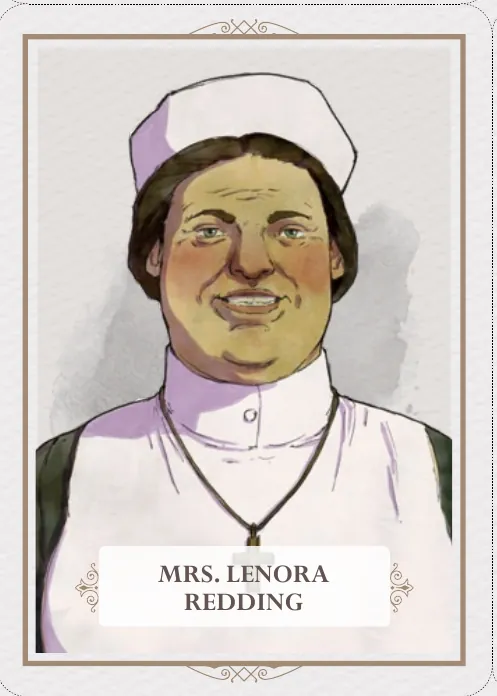

```stat
Ближний бой (драка) 50% (25/10), урон 1d8+БкУ.
Уклонение 42% (21/8).
Навыки: Слух 75%, Нюх 90%.
```

## Миссис Ленора Реддинг

*53 года. Сиделка. Средний класс (средний достаток).*

Ленора Реддинг — измученная душа, целиком порабощённая доктором Дьюаром из-за сочетания строгого воспитания, неразвитой и покорной натуры и необходимости подавлять свои сексуальные предпочтения; всё это питает в ней глубокое отвращение к себе, которое она пытается скрыть за вечной приклеенной улыбкой. Её ненависть направлена не только на неё саму, но и на всех остальных, особенно на тех, кто счастлив.

**Имущество:** на шее она носит большое распятие, а в одном из карманов держит копию маленькой музыкальной шкатулки Фиделии. Ещё при ней ключи от кухонной двери, ведущей из особняка наружу, маленький ключ от фортепиано и ключи от бара в гостиной, шкафов лазарета, покоев леди Эдны и процедурной, комнаты миссис Юнис, комнаты Бердетта, лаборатории с её ящиками и шкафами с опасными веществами, своей комнаты, погреба, лесных ворот и часовни.

**Внешность и поведение:** всегда улыбается и кивает, приторно вежлива. Для отыгрыша миссис Реддинг представьте актрису Веронику Форке.

```stat
СИЛ 35   ВЫН 45   ТЕЛ 75   ЛВК 45   ИНТ 70
НАР 45   МОЩ 25   ОБР 75   Рассудок 00   ПЗ 12

Бонус к урону: нет.
Комплекция: 0
Скорость: 5
Ближний бой (драка) 30% (15/6), урон 1d3+БкУ.
Уклонение 50% (25/10).
Навыки: Бухгалтерское дело 15%, Искусство/ремесло (парикмахерское дело) 30%, Обаяние 40%, Средства 15%, Уклонение 50%, Вождение автомобиля 30%, Красноречие 50%, Ближний бой (драка) 30%, Первая помощь 45%, История 30%, Запугивание 30%, Работа в библиотеке 40%, Слух 80%, Иностранный язык (латынь) 17%, Родной язык (английский) 75%, Механика 26%, Медицина 20%, Убеждение 40%, Психология 25%, Наука (биология) 20%, Наука (ботаника) 20%, Наука (химия) 20%, Наука (фармакология) 40%, Наука (зоология) 20%, Ловкость рук 35%, Внимание 50%, Скрытность 30%, Метание 30%.
```



## Мисс (Мэри) Элизабет Милфорд

*19 лет. Горничная в полузабытьи. Рабочий класс (нищая).*

Мэри Беннет — таково настоящее имя этой женщины — один из первых опытов доктора Дьюара. Её наняли пополнить скудный штат замка Дьюар, когда остальные слуги решили предать лэрда. Чего ни аристократ, ни Дав не подозревали, так это того, что мисс Беннет была очень нечиста на руку.

Отважная маленькая воровка попыталась обокрасть доктора. В наказание он решил использовать её для отработки своих приёмов гипноза и переселения душ, пытаясь превратить её в одну из убитых им горничных. Помимо многого другого, он подвергал её долгим периодам лишения сна. В результате молодая женщина больше не может спать, что делает её очень работящей горничной. Разумеется, она и не вполне бодрствует, а пребывает в своего рода вечном оцепенении, из-за чего за ней нужен постоянный присмотр и ей нельзя поручать ничего сложного. Сознание молодой женщины то проясняется, то мутится. В те моменты, когда её разум затуманен сильнее всего, Мэри надевает белое платье Фиделии, вылезает из окна своей спальни и спускается по дереву в атриуме, чтобы посреди ночи погулять по садам. Это остаток установки, которую доктор внедрил в её подсознание.
