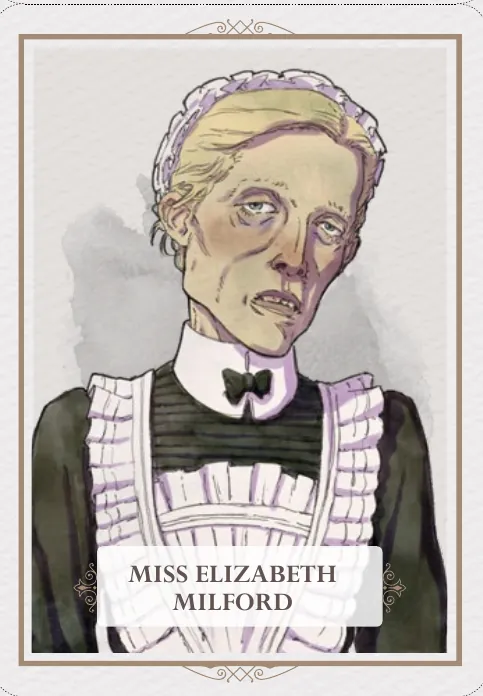
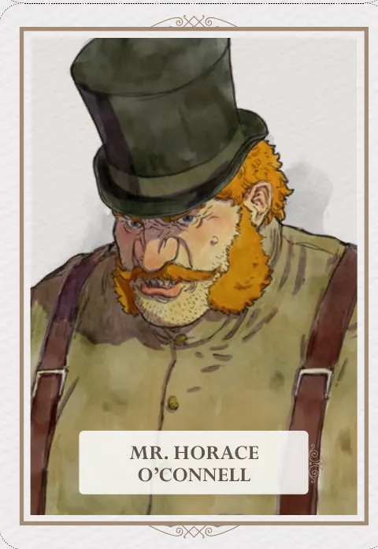

**Имущество:** ключ от кухонной двери, ведущей наружу, а также от двери, ведущей из атриума, маленький ключ от фортепиано и ключи от покоев Коллингвуда, спален сыщиков, комнаты миссис Юнис, спальни Бердетта и погреба.

**Внешность и поведение:** измождённая, с тёмными кругами под глубоко запавшими глазами, бледная и долговязая, кожа да кости, — она похожа на ходячий скелет. Время от времени она замирает в оцепенении с открытым ртом, обнажая ряд длинных, кривых, как у грызуна, зубов. В другой жизни она могла бы быть привлекательной женщиной. На своё имя она не откликается. Когда она не выполняет медленно и однообразно механические движения своей работы, она держит руки сложенными на переднике. Она обычно смотрит в землю, редко поднимает взгляд и не говорит. Иногда, когда её выводят из задумчивости, она кажется ошеломлённой или вздрагивает, и, похоже, живёт в постоянном ужасе.

```stat
СИЛ 35   ВЫН 35   ТЕЛ 45   ЛВК 55   ИНТ 50
НАР 50   МОЩ 15   ОБР 50   Рассудок 00   ПЗ 8

Бонус к урону: −1
Комплекция: −1
Скорость: 8
Ближний бой (драка) 30% (15/6), урон 1d3+БкУ.
Уклонение 50% (25/10).
Навыки: Оценка 30%, Искусство/ремесло (кулинария) 45%, Обаяние 30%, Лазание 80%, Средства 00%, Маскировка 50%, Уклонение 50%, Ближний бой (драка) 30%, Прыжки 60%, Родной язык (английский) 50%, Слух 65%, Взлом 55%, Механика 30%, Ловкость рук 60%, Внимание 40%, Скрытность 80%.
```



## Мистер Хорас О’Коннелл и его бригада

*41 год. Бригадир. Рабочий класс (бедный).*

Эти ирландцы делают вид, что ремонтируют опалённые стены, а на самом деле они здесь, чтобы не дать сыщикам сбежать из поместья. Для этого, помимо запугивания или насилия, Хорас знает гипнотическое слово-ключ, вызывающее иллюзию химеры. Персонажам не стоит недооценивать эту шайку громил. Лорд Дьюар хорошо им платит, и они не первый раз в деле. К тому же они привыкли работать сообща. Всего их около двадцати, хотя на стенах одновременно редко бывает больше восьми.

**Другие члены бригады:** Арнольд О’Мира, Беннет О’Тул, Кэлвин О’Салливан.

**Имущество:** железный лом, фляжка и жевательный табак.


