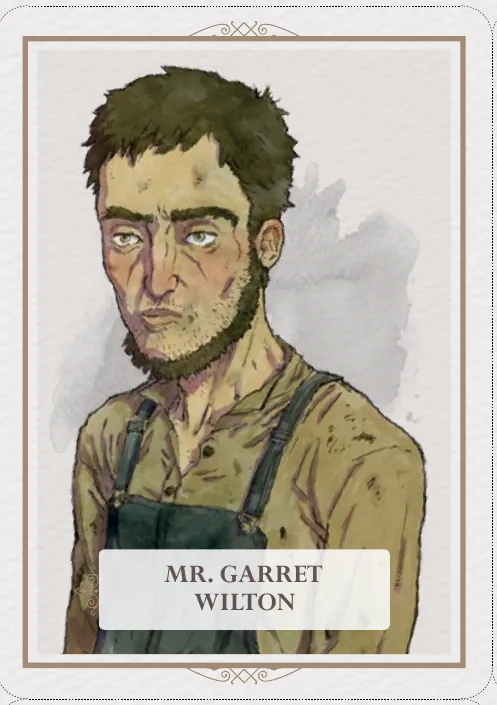

**Внешность и поведение:** здоровенный, грязный и плохо выбритый, он вызывающе жуёт табак, демонстративно сплёвывая, чтобы показать своё неуважение. Он не любит заносчивых господ и вообще всех, кто не ирландец, и не скрывает этого. Он ворчит, бранится и отвечает отрывисто и односложно, словно раздражён тем, что сыщики тратят его время. Но, несмотря на явную враждебность, ни он, ни его люди никогда не потеряют терпения, как бы их ни провоцировали. Это не значит, что они не нападут на сыщиков, но если нападут, то это будет холодное, сознательное решение, а не порыв минуты.

```stat
СИЛ 70   ВЫН 60   ТЕЛ 70   ЛВК 65   ИНТ 50
НАР 55   МОЩ 55   ОБР 45   Рассудок 55   ПЗ 13

Бонус к урону: +1d6.
Комплекция: 2
Скорость: Хорас 7; остальные члены бригады 8.
Ближний бой (драка) 60% (30/12), урон 1d8+БкУ.
Уклонение 50% (25/10).
Навыки: Искусство/ремесло (строительство) 30%, Лазание 45%, Средства 05%, Уклонение 50%, Красноречие 40%, Ближний бой (драка) 60%, Стрельба (винтовка/дробовик) 40%, Первая помощь 30%, Запугивание 70%, Прыжки 30%, Родной язык (английский) 45%, Слух 50%, Механика 30%, Ловкость рук 25%, Внимание 50%, Скрытность 30%, Метание 50%, Чтение следов 30%.
```

*Прим. перев.: так в оригинале — при СИЛ 70 и ТЕЛ 70 (сумма 140) по таблице бонус к урону +1d4 и Комплекция 1, а напечатано +1d6 и 2.*

## Мистер Гаррет Уилтон

*28 лет. Помешанный конюх. Рабочий класс (нищий).*

Гаррет осиротел пятнадцать лет назад и унаследовал от отца обязанности конюха лорда Дьюара. У него умеренная умственная отсталость и вдобавок пограничное расстройство личности — состояние, которое лишь усугубили его пьянство, сексуальные навязчивости и соседство сестёр Шерман, которым всегда доставляло извращённое удовольствие мучить его своими выходками.

Бригада Хораса тоже не слишком дружелюбна к бедняге. Сначала они дразнили и высмеивали его, но вскоре эта забава им надоела, и теперь они просто прогоняют его, завидев издали.

Его единственный «друг» — рыбак Питер Хелм, который снабжает его дешёвым вином в обмен на те деньги, что ему удаётся выманить у Дава, или на изредка стащенную у пастушек головку сыра. Бутылки он обычно прячет в конюшне.

**Имущество:** при нём неизменно зелёная стеклянная бутылка, из которой он может прихлёбывать в любое время дня и которой может воспользоваться как самодельным оружием.

**Внешность и поведение:** очень высокий, хотя и довольно тощий. Грязный, кишащий клопами и вшами. Он постоянно чешется и у всех на виду трогает себя между ног. Как правило, он избегает смотреть в глаза: когда говорит, опускает взгляд или смотрит вдаль. Но время от времени, в как будто случайные моменты, он уставится прямо на собеседника с неприкрытой кипящей ненавистью. Всякий раз, когда может (или когда не может удержаться), он украдкой оценивающе поглядывает на женщин, подстёгиваемый животной похотью. Не хватает только, чтобы он облизывался и пускал слюни, — что он порой тоже может делать. Говорит он короткими отрывистыми фразами, словно всё время злится. Отыгрывая его, не делайте его недуг слишком явным или тяжёлым. Старайтесь быть тоньше, держась на грани обычной дееспособности.


