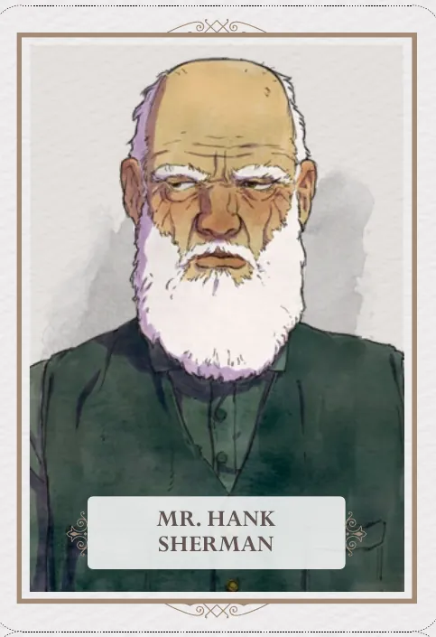

```stat
СИЛ 55   ВЫН 45   ТЕЛ 55   ЛВК 55   ИНТ 30
НАР 45   МОЩ 15   ОБР 50   Рассудок 08   ПЗ 10

Бонус к урону: нет.
Комплекция: 0
Скорость: 8
Ближний бой (драка) 50% (25/10), урон 1d6+БкУ.
Уклонение 50% (25/10).
Навыки: Обращение с животными 50%, Искусство/ремесло (выделка кожи) 30%, Лазание 35%, Средства 00%, Уклонение 50%, Красноречие 30%, Ближний бой (драка) 50%, Первая помощь 20%, Запугивание 35%, Прыжки 40%, Родной язык (английский) 50%, Слух 30%, Механика 30%, Естествознание 30%, Ориентирование 20%, Верховая езда 35%, Внимание 40%, Скрытность 45%, Метание 30%, Чтение следов 30%.
```

## Мистер Хэнк Шерман

*62 года. Пастух. Рабочий класс (бедный).*

Хэнк — муж Пэтси и отец Эстер, Амелии и Флоры. Это робкий, необразованный, суеверный человек, который живёт в тени жены и старается не высовываться, хотя ему не всегда удаётся скрыть тлеющую обиду. Супруги явно знают больше, чем говорят, и у них припрятан в рукаве не один козырь. Это викторианский аналог парочки деревенщин-людоедов из глубинки современной Америки — разве что человечину они не едят.

**Имущество:** у Хэнка обычно под рукой какое-нибудь тупое орудие. У него также есть ключ от висячего замка логова, которое они устроили для Селины Бейнбридж в свинарнике.

**Внешность и поведение:** Хэнк немногословен. Он лишь кивает, склоняет голову и делает всё, о чём просит жена. С сыщиками он будет обходиться почтительно и извинится за любые вольности со стороны дочерей, но в разговор с ними вступать не станет и явно будет надеяться, что они поскорее уберутся. Он едва вымолвит слово, а если и заговорит, то скорее забормочет себе под нос, чем попытается что-то сказать другим.

```stat
СИЛ 50   ВЫН 50   ТЕЛ 75   ЛВК 50   ИНТ 60
НАР 45   МОЩ 30   ОБР 45   Рассудок 18   ПЗ 12

Бонус к урону: +1d4
Комплекция: 1
Скорость: 4
Ближний бой (драка) 42% (21/8), урон 1d8+БкУ.
Уклонение 42% (21/8).
Навыки: Обращение с животными 60%, Искусство/ремесло (садоводство) 45%, Искусство/ремесло (стрижка овец) 65%, Лазание 42%, Средства 05%, Уклонение 42%, Ближний бой (драка) 42%, Стрельба (винтовка/дробовик) 30%, Первая помощь 30%, Запугивание 34%, Прыжки 40%, Родной язык (английский) 45%, Слух 65%, Механика 40%, Естествознание 60%, Ориентирование 50%, Психология 30%, Внимание 40%, Скрытность 55%, Выживание (горы) 20%, Плавание 30%, Метание 46%, Чтение следов 68%.
```



## Миссис Пэтси Шерман

*50 лет. Пастушка. Рабочий класс (бедная).*

Пэтси — жена Хэнка и мать Эстер, Амелии и Флоры. Это необразованная, суеверная женщина, которая не боится высказывать своё мнение, даже когда толком не подумала или понятия не имеет, о чём говорит. В браке командует она: распоряжается теми немногими деньгами, что приходят в дом, и решает, что делать. Она всегда считает себя правой.
